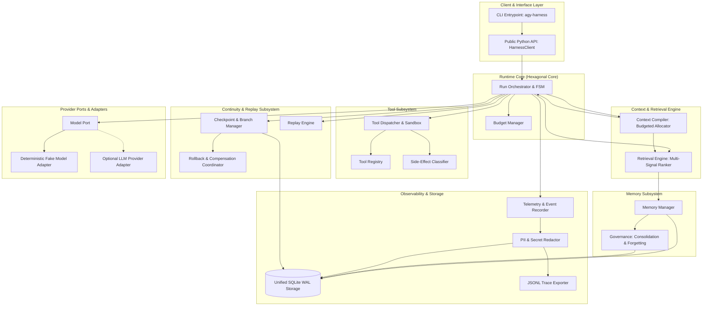
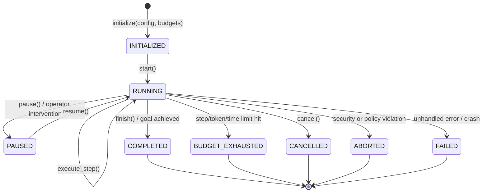
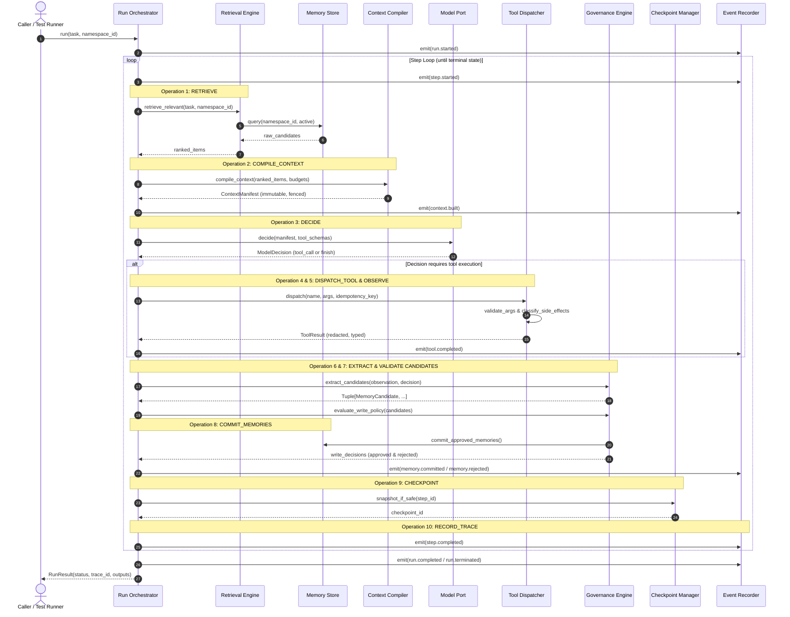
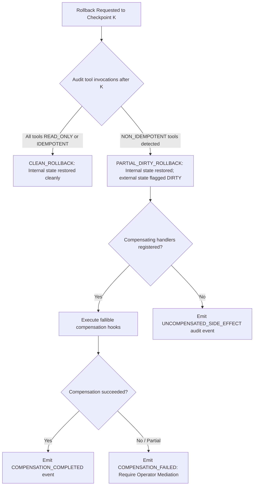

# ARCHITECTURE.md: Memory-Aware Agent Harness Architecture

**Status:** PROPOSED (Phase 0 Architecture Revision 2)  
**Architecture Style:** Modular Monolith with Ports-and-Adapters (Hexagonal Architecture)  
**Target Runtime:** Python 3.11+, Local-First Single Process  
**Specification Reference:** [SPEC.md](file:///Users/apple/Projects/memory-aware-agent-harness/SPEC.md)

---

## 1. Architectural Principles & System Decomposition

The `memory-aware-agent-harness` is designed as an inspectable, deterministic, modular single-agent runtime where memory operations participate in core execution decisions rather than existing as an external retrieval service.

### Core Architectural Principles
1. **Hexagonal Boundaries (Ports & Adapters):** Core domain logic (lifecycle FSM, memory models, ranking, context compilation) is insulated from external infrastructure (SQLite, LLM providers, file systems) through typed Python `Protocol` interfaces.
2. **Deep Immutability & Data Contracts:** Public data records are frozen dataclasses using immutable collections (`Tuple`, `Mapping`) to prevent accidental internal state mutation.
3. **Unified Durable Storage with Categorical Indexing:** The four behavioral memory categories (working, episodic, semantic, procedural) reside in a unified `memory_records` table with indexed `kind` discriminators, avoiding unnecessary schema fragmentation.
4. **Honest Side-Effect Boundaries:** Checkpoint rollback cleanly restores internal computational state, but explicitly acknowledges that external physical mutations cannot be magically reversed. Compensation handlers are fallible, and unreversed effects are explicitly recorded.
5. **Deterministic-by-Default:** First-class deterministic test doubles (`FakeModelAdapter`, `DeterministicClock`, `SeedableRNG`, `StubToolDispatcher`) allow 100% offline testing without network access or API keys.
6. **Early Packaging & Validation:** Project packaging (`pyproject.toml`), linters, strict typing, and basic CI scaffolding are established in Phase 0 rather than deferred to the end of the project.

---

## 2. System Topology & Component Diagram



---

## 3. Execution Lifecycle FSM: States vs. Operations

The harness strictly differentiates **Run States** (the lifecycle condition of the run) from **Step Operations** (the discrete computational steps executed during an active turn).

### 3.1 Formal Run State Transitions



#### Run States
- `INITIALIZED`: Run created; configuration, namespace, and budgets validated.
- `RUNNING`: Actively executing steps in the main loop.
- `PAUSED`: Execution suspended pending external approval, human-in-the-loop, or crash recovery.
- `COMPLETED`: Run successfully finished; goal achieved.
- `BUDGET_EXHAUSTED`: Execution cleanly halted due to step, token, or wall-clock budget exhaustion.
- `CANCELLED`: Execution cancelled by caller request.
- `ABORTED`: Execution terminated immediately due to security violation or policy refusal.
- `FAILED`: Execution terminated due to unhandled exception, storage failure, or unrecoverable error.

### 3.2 Step Execution Lifecycle & Sequence Diagram

During the `RUNNING` state, each step executes the following ordered operations:



---

## 4. Public API & Typed Contract Signatures

All core interfaces are expressed using strict Python `typing.Protocol` and immutable dataclasses with deep immutability (`Tuple`, `Mapping`).

```python
"""memory_aware_agent_harness.contracts: Complete public type contracts."""
from __future__ import annotations
from dataclasses import dataclass, field
from datetime import datetime
from enum import Enum
from types import MappingProxyType
from typing import Any, Dict, List, Mapping, Optional, Protocol, Sequence, Tuple, Union, runtime_checkable

# --- Strong Identifiers ---
RunId = str
StepId = str
MemoryId = str
NamespaceId = str
CheckpointId = str
BranchId = str
EventId = str
ToolInvocationId = str

# --- Enumerations ---
class RunStatus(str, Enum):
    INITIALIZED = "initialized"
    RUNNING = "running"
    PAUSED = "paused"
    COMPLETED = "completed"
    BUDGET_EXHAUSTED = "budget_exhausted"
    CANCELLED = "cancelled"
    ABORTED = "aborted"
    FAILED = "failed"

class MemoryKind(str, Enum):
    WORKING = "working"
    EPISODIC = "episodic"
    SEMANTIC = "semantic"
    PROCEDURAL = "procedural"

class MemoryState(str, Enum):
    ACTIVE = "active"
    SUPERSEDED = "superseded"
    EXPIRED = "expired"
    DELETED = "deleted"

class SideEffectType(str, Enum):
    READ_ONLY = "read_only"
    IDEMPOTENT_WRITE = "idempotent_write"
    NON_IDEMPOTENT_WRITE = "non_idempotent_write"

class ToolCallStatus(str, Enum):
    PENDING = "pending"
    COMPLETED = "completed"
    FAILED = "failed"
    OUTCOME_UNKNOWN = "outcome_unknown"

class ModelFinishReason(str, Enum):
    TOOL_CALL = "tool_call"
    STOP = "stop"
    LENGTH = "length"
    ERROR = "error"

# --- Public Immutable Data Records ---
@dataclass(frozen=True)
class ToolCallRequest:
    call_id: str
    tool_name: str
    arguments: Mapping[str, Any]

@dataclass(frozen=True)
class ModelDecision:
    decision_id: str
    step_id: str
    finish_reason: ModelFinishReason
    content: Optional[str] = None
    tool_calls: Tuple[ToolCallRequest, ...] = field(default_factory=tuple)
    tokens_used: int = 0
    raw_response: Optional[Mapping[str, Any]] = None

@dataclass(frozen=True)
class ToolResult:
    invocation_id: ToolInvocationId
    tool_name: str
    status: ToolCallStatus
    side_effect: SideEffectType
    idempotency_key: str
    result: Optional[Mapping[str, Any]] = None
    error: Optional[str] = None
    execution_time_ms: float = 0.0

@dataclass(frozen=True)
class MemoryRecord:
    id: MemoryId
    namespace_id: NamespaceId
    kind: MemoryKind
    content: str
    state: MemoryState
    confidence: float  # 0.0 to 1.0
    salience: float    # 0.0 to 1.0
    created_at: datetime
    updated_at: datetime
    expires_at: Optional[datetime] = None
    source_references: Tuple[str, ...] = field(default_factory=tuple)
    metadata: Mapping[str, Any] = field(default_factory=lambda: MappingProxyType({}))
    access_count: int = 0
    version: int = 1

@dataclass(frozen=True)
class MemoryCandidate:
    candidate_id: str
    namespace_id: NamespaceId
    kind: MemoryKind
    content: str
    proposed_salience: float
    source_step_id: StepId
    rationale: str
    validation_status: str  # PENDING, APPROVED, REJECTED
    rejection_reason: Optional[str] = None

@dataclass(frozen=True)
class ContextItem:
    memory_id: MemoryId
    kind: MemoryKind
    content: str
    rank_score: float
    provenance_id: str
    token_cost: int

@dataclass(frozen=True)
class ContextManifest:
    manifest_id: str
    step_id: StepId
    included_items: Tuple[ContextItem, ...]
    excluded_item_ids: Mapping[MemoryId, str]  # memory_id -> reason
    total_tokens: int
    budget_limit: int
    compiled_prompt: str

@dataclass(frozen=True)
class StepResult:
    step_id: StepId
    run_id: RunId
    step_number: int
    decision: ModelDecision
    tool_results: Tuple[ToolResult, ...]
    memories_proposed: int
    memories_committed: int
    tokens_consumed: int
    completed_at: datetime

@dataclass(frozen=True)
class RunResult:
    run_id: RunId
    namespace_id: NamespaceId
    status: RunStatus
    step_count: int
    total_tokens_consumed: int
    final_output: Optional[str]
    trace_id: str
    error: Optional[str] = None

# --- Typed Error Hierarchy ---
class HarnessError(Exception):
    """Base class for all harness exceptions."""

class BudgetExceededError(HarnessError):
    """Raised when token, step, or wall-clock budget is exceeded."""

class PolicyViolationError(HarnessError):
    """Raised when an operation violates security or safety policy."""

class ToolExecutionError(HarnessError):
    """Raised when tool execution fails in the sandbox."""

class CompensationFailedError(HarnessError):
    """Raised when fallible compensation fails during rollback."""

class ReplayDivergenceError(HarnessError):
    """Raised when deterministic replay deviates from recorded trace."""

class StorageError(HarnessError):
    """Raised on database integrity or persistence failure."""

# --- Core Public Ports (Protocols) ---
@runtime_checkable
class ModelPort(Protocol):
    """Port for soliciting structured decisions from LLMs or test doubles."""
    def decide(
        self, manifest: ContextManifest, tools_schema: Sequence[Mapping[str, Any]]
    ) -> ModelDecision: ...

@runtime_checkable
class MemoryStoreProtocol(Protocol):
    """Port for multi-tier durable memory persistence in unified storage."""
    def put(self, record: MemoryRecord) -> None: ...
    def get(self, memory_id: MemoryId, namespace_id: NamespaceId) -> Optional[MemoryRecord]: ...
    def search(
        self, namespace_id: NamespaceId, query: str, kinds: Sequence[MemoryKind], limit: int
    ) -> Sequence[MemoryRecord]: ...
    def tombstone(self, memory_id: MemoryId, namespace_id: NamespaceId, reason: str) -> None: ...
    def list_active(self, namespace_id: NamespaceId, kind: MemoryKind) -> Sequence[MemoryRecord]: ...

@runtime_checkable
class ToolProtocol(Protocol):
    """Port for executable agent tools."""
    name: str
    description: str
    side_effect: SideEffectType
    def get_schema(self) -> Mapping[str, Any]: ...
    def execute(self, arguments: Mapping[str, Any]) -> Mapping[str, Any]: ...
```

---

## 5. Storage Schema: Unified SQLite WAL Architecture

Per the approved architectural direction, **the four behavioral memory categories do not require four separate database tables**. All memories reside in a unified `memory_records` table partitioned by `kind` with composite index coverage:

```sql
PRAGMA journal_mode = WAL;
PRAGMA synchronous = NORMAL;
PRAGMA foreign_keys = ON;

-- 1. Runs Table
CREATE TABLE IF NOT EXISTS runs (
    run_id TEXT PRIMARY KEY,
    session_id TEXT NOT NULL,
    namespace_id TEXT NOT NULL,
    status TEXT NOT NULL,
    step_count INTEGER NOT NULL DEFAULT 0,
    max_steps INTEGER NOT NULL,
    token_budget INTEGER NOT NULL,
    tokens_consumed INTEGER NOT NULL DEFAULT 0,
    created_at TEXT NOT NULL,
    completed_at TEXT
);
CREATE INDEX IF NOT EXISTS idx_runs_namespace ON runs(namespace_id, created_at);

-- 2. Run Steps Table
CREATE TABLE IF NOT EXISTS run_steps (
    step_id TEXT PRIMARY KEY,
    run_id TEXT NOT NULL REFERENCES runs(run_id) ON DELETE CASCADE,
    step_number INTEGER NOT NULL,
    state TEXT NOT NULL,
    context_manifest_id TEXT,
    model_decision_json TEXT,
    started_at TEXT NOT NULL,
    completed_at TEXT,
    UNIQUE(run_id, step_number)
);

-- 3. Unified Memory Records Table (All 4 Categories)
CREATE TABLE IF NOT EXISTS memory_records (
    memory_id TEXT PRIMARY KEY,
    namespace_id TEXT NOT NULL,
    kind TEXT NOT NULL, -- 'working', 'episodic', 'semantic', 'procedural'
    content TEXT NOT NULL,
    state TEXT NOT NULL, -- 'active', 'superseded', 'expired', 'deleted'
    confidence REAL NOT NULL DEFAULT 1.0,
    salience REAL NOT NULL DEFAULT 0.5,
    access_count INTEGER NOT NULL DEFAULT 0,
    version INTEGER NOT NULL DEFAULT 1,
    created_at TEXT NOT NULL,
    updated_at TEXT NOT NULL,
    expires_at TEXT,
    metadata_json TEXT
);
CREATE INDEX IF NOT EXISTS idx_memories_active 
ON memory_records(namespace_id, kind, state) 
WHERE state = 'active';

-- 4. Memory Lineage & Provenance Table
CREATE TABLE IF NOT EXISTS memory_lineage (
    id INTEGER PRIMARY KEY AUTOINCREMENT,
    target_memory_id TEXT NOT NULL REFERENCES memory_records(memory_id) ON DELETE CASCADE,
    source_reference_id TEXT NOT NULL,
    relationship TEXT NOT NULL -- 'derived_from', 'consolidated_from', 'supersedes'
);
CREATE INDEX IF NOT EXISTS idx_lineage_target ON memory_lineage(target_memory_id);

-- 5. Tombstones Table (Physical Audit of Verifiable Deletion)
CREATE TABLE IF NOT EXISTS tombstones (
    tombstone_id TEXT PRIMARY KEY,
    target_memory_id TEXT NOT NULL,
    namespace_id TEXT NOT NULL,
    reason TEXT NOT NULL,
    tombstoned_at TEXT NOT NULL
);
CREATE INDEX IF NOT EXISTS idx_tombstones_lookup ON tombstones(namespace_id, target_memory_id);

-- 6. Tool Invocations Table
CREATE TABLE IF NOT EXISTS tool_invocations (
    invocation_id TEXT PRIMARY KEY,
    step_id TEXT NOT NULL REFERENCES run_steps(step_id) ON DELETE CASCADE,
    tool_name TEXT NOT NULL,
    arguments_json TEXT NOT NULL,
    side_effect TEXT NOT NULL, -- 'read_only', 'idempotent_write', 'non_idempotent_write'
    idempotency_key TEXT NOT NULL,
    status TEXT NOT NULL, -- 'pending', 'completed', 'failed', 'outcome_unknown'
    result_json TEXT,
    error_text TEXT,
    dispatched_at TEXT NOT NULL,
    completed_at TEXT
);
CREATE INDEX IF NOT EXISTS idx_tool_idempotency ON tool_invocations(idempotency_key);

-- 7. Checkpoints Table
CREATE TABLE IF NOT EXISTS checkpoints (
    checkpoint_id TEXT PRIMARY KEY,
    run_id TEXT NOT NULL REFERENCES runs(run_id) ON DELETE CASCADE,
    step_id TEXT NOT NULL REFERENCES run_steps(step_id) ON DELETE CASCADE,
    branch_id TEXT NOT NULL,
    parent_checkpoint_id TEXT,
    state_payload_json TEXT NOT NULL,
    created_at TEXT NOT NULL
);

-- 8. Trace Events Table (Append-Only Log)
CREATE TABLE IF NOT EXISTS trace_events (
    event_id TEXT PRIMARY KEY,
    run_id TEXT NOT NULL REFERENCES runs(run_id) ON DELETE CASCADE,
    step_id TEXT,
    sequence_num INTEGER NOT NULL,
    event_type TEXT NOT NULL,
    payload_json TEXT NOT NULL,
    emitted_at TEXT NOT NULL
);
CREATE INDEX IF NOT EXISTS idx_events_sequence ON trace_events(run_id, sequence_num);
```

---

## 6. Rollback vs. Irreversible Side Effects Architecture

The harness enforces strict physical realism in its rollback model:



### 6.1 State Rollback Guarantees
- **Internal State:** Working memory, step counter, active plan, and uncommitted candidate memories are restored cleanly to the snapshot state at Checkpoint $K$.
- **External State:** External physical actions cannot be magically un-executed.
- **Fallible Compensation:** If compensation handlers exist, they are executed in reverse chronological order. If any compensation call fails, execution enters `PAUSED` state with status `PARTIAL_DIRTY_ROLLBACK` requiring human operator reconciliation.

---

## 7. Deterministic Replay & Version Compatibility

Replay determinism is strictly scoped to **canonical recorded inputs and outputs under compatible schema versions**:
1. **Deterministic Guarantees:** When replaying a recorded trace using `DeterministicClock`, `SeedableRNG`, `FakeModelAdapter`, and `StubToolDispatcher`, the harness guarantees bit-for-bit identical state transitions.
2. **Compatibility Guard:** If the current runtime schema version does not match `trace_event.schema_version`, or if policy versions diverge, the replayer emits a `ReplayDivergenceWarning` or halts with `ReplayDivergenceError`.
3. **Out-of-Scope:** Replay against live external LLMs or live third-party tools is non-deterministic by definition and explicitly out of scope.

---

## 8. Multi-Boundary Forgetting & Physical Erasure

The harness coordinates retention and forgetting across six storage boundaries:
1. **Memory Records:** Retrieval exclusion via `state = 'deleted'` and tombstone lookup; physical removal via `DELETE` query and SQLite `VACUUM`.
2. **Trace Events:** Retention limit pruning based on `retention_days`; summary tombstone record preserved.
3. **Checkpoints:** Expired snapshot pruning; cascade deletion of child snapshots when parent run is scrubbed.
4. **In-Memory Caches:** Instant cache key eviction on tombstone emission.
5. **Exported Artifacts:** Exclusion filters omit tombstoned records during JSONL export; secure disk shredding for deleted runs.
6. **Backups:** Point-in-time restore scripts apply tombstone filters during rehydration.

---

## 9. Proposed Repository Structure (Updated for Phase 0 Packaging)

```text
memory-aware-agent-harness/
├── README.md
├── SPEC.md
├── ARCHITECTURE.md
├── ROADMAP.md
├── pyproject.toml                 # Phase 0: Packaging & tools configuration
├── .github/
│   └── workflows/
│       └── ci.yml                 # Phase 0: GitHub Actions basic CI pipeline
├── src/memory_aware_agent_harness/
│   ├── __init__.py                # Package version definition
│   ├── api.py                    # Public entrypoint (HarnessClient, RunConfig)
│   ├── contracts.py              # Public Protocols, dataclasses, enums
│   ├── runtime/                  # Phase 1: Core Runtime (FSM, orchestrator, budgets)
│   ├── memory/                   # Phase 2: Memory Model (working, episodic, semantic, procedural)
│   ├── storage/                  # Phase 2: Unified SQLite WAL Persistence
│   ├── retrieval/                # Phase 3: Retrieval & Ranking (multi-signal score)
│   ├── context/                  # Phase 3: Context Compilation (manifest, partition budget)
│   ├── governance/               # Phase 4: Memory Governance (candidates, consolidate, forget)
│   ├── tools/                    # Phase 5: Tool Runtime (registry, dispatcher, idempotency)
│   ├── checkpoint/               # Phase 6: Checkpointing (snapshots, branch DAG, rollback)
│   ├── telemetry/                # Phase 7: Tracing & Provenance (events, redactor, exporter)
│   ├── replay/                   # Phase 8: Replay Engine (trace replayer, deterministic doubles)
│   ├── evaluation/               # Phase 9: Evaluation Engine (metrics, baselines, runner)
│   ├── benchmarks/               # Phase 10: Reproducible Benchmarks (frozen suites, reporting)
│   └── integrations/             # Phase 11: Adapters & Demos (fake/real adapters, 3 demos)
├── tests/
│   ├── unit/                     # Focused unit tests per module
│   ├── integration/              # Multi-tier lifecycle tests
│   ├── failure/                  # Crash injection, timeout & corruption tests
│   ├── fixtures/                 # Frozen mock data & traces
│   └── conftest.py
├── examples/
│   ├── 01_cross_session_continuity.py
│   ├── 02_crash_recovery_idempotency.py
│   └── 03_privacy_forgetting_tombstones.py
└── docs/
    ├── adr/                      # Architecture Decision Records (ADR-001 to ADR-010)
    ├── lifecycle.md
    ├── memory_models.md
    └── security.md
```

---

## 10. Architecture Decision Records (ADRs)

| ADR ID | Title | Summary of Decision | Reversal Trigger |
|---|---|---|---|
| **ADR-001** | Modular Monolith vs. Distributed Extension | Single-process Python 3.11+ modular monolith with ports-and-adapters. Zero RPC latency. | Multi-agent distributed concurrency becomes an explicit requirement. |
| **ADR-002** | Unified SQLite Table for Four Memory Categories | Single `memory_records` table with indexed `kind` column rather than 4 separate tables. | Empirical proof of table lock contention across memory tiers. |
| **ADR-003** | SQLite WAL Persistence as Reference Storage | SQLite in WAL mode with transactional boundaries and strict namespace indexing. | Distributed multi-node persistence required. |
| **ADR-004** | Multi-Signal Retrieval & Budgeted Manifest | Combines lexical/BM25 relevance, recency decay, salience, and access frequency. | Learned re-ranker reliably outperforms within latency budget. |
| **ADR-005** | Candidate Quarantine & Explicit Write Policy | Extracted memories are quarantined as `MemoryCandidate` until passed by policy. | None (core safety invariant). |
| **ADR-006** | State Rollback vs. Fallible Side-Effect Compensation | Internal state resets cleanly; external side effects are flagged dirty; compensation is fallible. | None (fundamental physical constraint). |
| **ADR-007** | Version-Bounded Deterministic Replay & Test Doubles | Determinism guaranteed only for recorded traces under compatible schema/model versions. | None (testing & CI requirement). |
| **ADR-008** | Multi-Boundary Verifiable Forgetting | Durable tombstones and TTL expiry with SQL-level exclusion and physical purge protocols. | None (privacy & compliance requirement). |
| **ADR-009** | Phase 0 Packaging & Scaffolding Strategy | Introduce minimal `pyproject.toml`, linters, and smoke CI in Phase 0 without runtime code. | None (standard engineering practice). |
| **ADR-010** | Deep Immutability in Public Data Contracts | Public records use frozen dataclasses with `Tuple` and `MappingProxyType` to prevent mutations. | None (contract integrity requirement). |