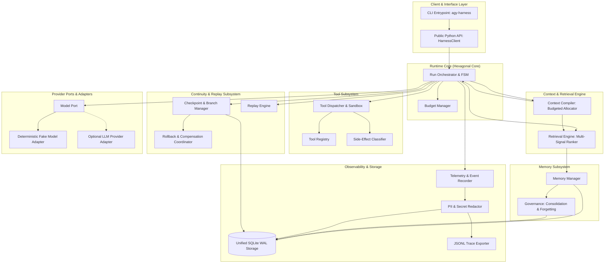
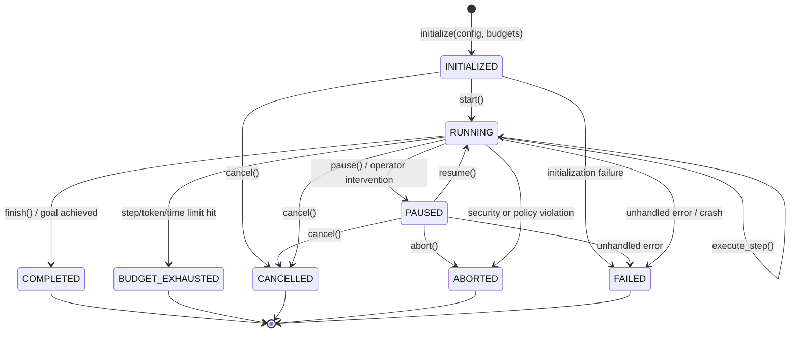
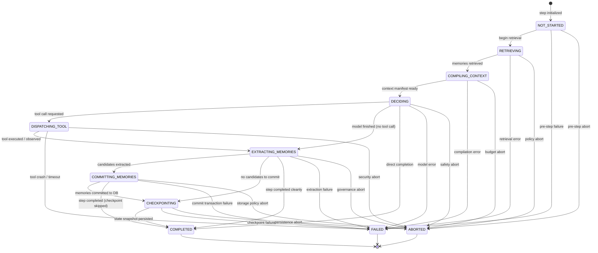
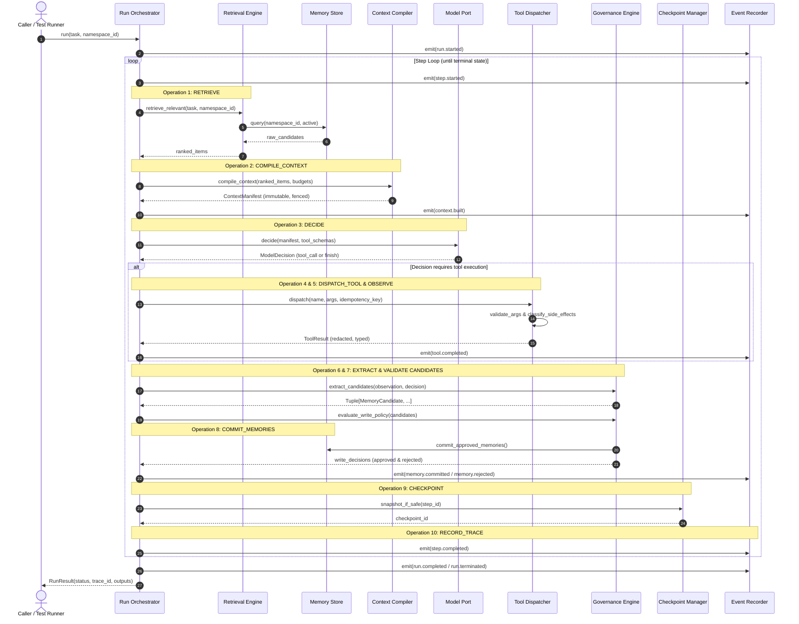
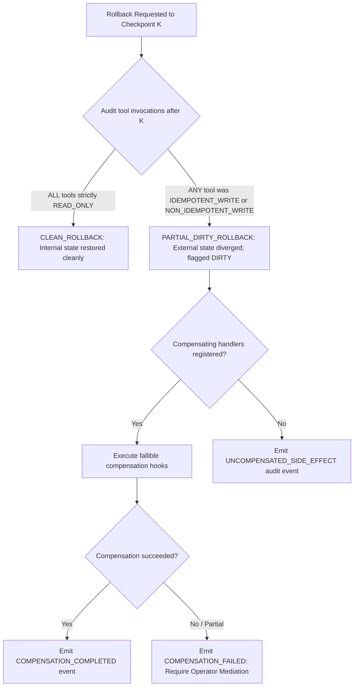

# ARCHITECTURE.md: Memory-Aware Agent Harness Architecture

**Status:** PROPOSED (Phase 0 Architecture Revision 2)  
**Architecture Style:** Modular Monolith with Ports-and-Adapters (Hexagonal Architecture)  
**Target Runtime:** Python 3.11+, Local-First Single Process  
**Specification Reference:** [SPEC.md](SPEC.md)

---

## 1. Architectural Principles & System Decomposition

The `memory-aware-agent-harness` is designed as an inspectable, deterministic, modular single-agent runtime where memory operations participate in core execution decisions rather than existing as an external retrieval service.

### Core Architectural Principles
1. **Hexagonal Boundaries (Ports & Adapters):** Core domain logic (lifecycle FSM, memory models, ranking, context compilation) is insulated from external infrastructure (SQLite, LLM providers, file systems) through typed Python `Protocol` interfaces.
2. **Deep Immutability & Data Contracts:** Public data records are frozen dataclasses using immutable collections (`Tuple`, `Mapping`) to prevent accidental internal state mutation.
3. **Unified Durable Storage with Categorical Indexing:** The four behavioral memory categories (working, episodic, semantic, procedural) reside in a unified `memory_records` table with indexed `kind` discriminators, avoiding unnecessary schema fragmentation.
4. **Honest Side-Effect Boundaries:** Checkpoint rollback cleanly restores internal computational state, but explicitly acknowledges that external physical mutations cannot be magically reversed. Compensation handlers are fallible, and unreversed effects are explicitly recorded.
5. **Deterministic-by-Default:** First-class deterministic test doubles (`FakeModelAdapter`, `DeterministicClock`, `SeedableRNG`, `StubToolDispatcher`) allow 100% offline testing without network access or API keys.
6. **Early Packaging & Validation:** Project packaging (`pyproject.toml`), linters, strict typing, and basic CI scaffolding are established in Phase 0 rather than deferred to the end of the project.

---

## 2. System Topology & Component Diagram



---

## 3. Execution Lifecycle FSM: States vs. Operations

The harness strictly differentiates **Run States** (the lifecycle condition of the run) from **Step Operations** (the discrete computational steps executed during an active turn).

### 3.1 Formal Run State Transitions



#### Run States
- `INITIALIZED`: Run created; configuration, namespace, and budgets validated. Can transition to `RUNNING`, or terminate early via `CANCELLED` or `FAILED`.
- `RUNNING`: Actively executing steps in the main loop. Can transition to `RUNNING` (loop), `PAUSED`, or any terminal state (`COMPLETED`, `BUDGET_EXHAUSTED`, `CANCELLED`, `ABORTED`, `FAILED`).
- `PAUSED`: Execution suspended pending external approval, human-in-the-loop, or crash recovery. Can resume to `RUNNING`, or terminate via `CANCELLED`, `ABORTED`, or `FAILED`.
- `COMPLETED`: Run successfully finished; goal achieved.
- `BUDGET_EXHAUSTED`: Execution cleanly halted due to step, token, or wall-clock budget exhaustion.
- `CANCELLED`: Execution cancelled by caller request.
- `ABORTED`: Execution terminated immediately due to security violation or policy refusal.
- `FAILED`: Execution terminated due to unhandled exception, storage failure, or unrecoverable error.

### 3.2 Step Execution Lifecycle & State Machine

Step execution within the `RUNNING` state is governed by a dedicated state machine (`StepState`) validated against `LEGAL_STEP_TRANSITIONS`:



During the `RUNNING` state, each standard step advances through the sequence below:



---

## 4. Public API & Typed Contract Signatures

All core interfaces are expressed using strict Python `typing.Protocol`, PEP 484 `NewType` strong identifiers, and immutable dataclasses with deep immutability (`Tuple`, `FrozenDict`) and canonical serialization (`SerializableRecord`).

> [!NOTE]
> The canonical implementation and living contract source is maintained at [`src/memory_aware_agent_harness/contracts.py`](src/memory_aware_agent_harness/contracts.py). Rather than duplicating 300+ lines of Python source in this architecture document, the sections below map every public component to its architectural role:

### 4.1 Strong Type Identifiers (PEP 484 NewType)
- `RunId`, `StepId`, `MemoryId`, `NamespaceId`, `CheckpointId`, `BranchId`, `EventId`, `ToolInvocationId`: Strong types preventing transposition errors across domain boundaries.

### 4.2 Lifecycle & Behavioral Enumerations
- `RunStatus`: Global execution states (`INITIALIZED`, `RUNNING`, `PAUSED`, `COMPLETED`, `BUDGET_EXHAUSTED`, `CANCELLED`, `ABORTED`, `FAILED`).
- `StepState`: Granular operational step phases (`NOT_STARTED`, `RETRIEVING`, `COMPILING_CONTEXT`, `DECIDING`, `DISPATCHING_TOOL`, `EXTRACTING_MEMORIES`, `COMMITTING_MEMORIES`, `CHECKPOINTING`, `COMPLETED`, `FAILED`, `ABORTED`).
- `MemoryKind`: Cognitive memory categories (`WORKING`, `EPISODIC`, `SEMANTIC`, `PROCEDURAL`).
- `MemoryState`: Record persistence lifecycle (`ACTIVE`, `SUPERSEDED`, `EXPIRED`, `DELETED`).
- `MemoryOrigin`: Provenance trust levels (`SYSTEM_PROVIDED`, `USER_EXPLICIT`, `AGENT_OBSERVATION`, `DERIVED_CONSOLIDATION`, `EXTERNAL_RETRIEVAL`).
- `CandidateStatus`: Candidate ingestion state (`PENDING`, `APPROVED`, `REJECTED`).
- `SideEffectType`: Tool impact rating (`READ_ONLY`, `IDEMPOTENT_WRITE`, `NON_IDEMPOTENT_WRITE`).
- `ToolCallStatus`: Invocation outcome state (`PENDING`, `COMPLETED`, `FAILED`, `OUTCOME_UNKNOWN`).
- `ModelFinishReason`: Completion classification (`TOOL_CALL`, `STOP`, `LENGTH`, `ERROR`).

### 4.3 FSM Transition Matrices
- `LEGAL_RUN_TRANSITIONS`: Frozen mapping of legal status transitions for the run-level FSM.
- `LEGAL_STEP_TRANSITIONS`: Frozen mapping of legal step phase transitions for the turn-level FSM.

### 4.4 Public Data Records (SerializableRecord)
- `RunBudgets`: Maximum step, token, and time limits for a run.
- `TokenUsage`: Detailed arithmetic accounting of prompt and completion token consumption.
- `ModelCallContext`: Turn-scoped context passed to model adapters.
- `ToolCallContext`: Invocation-scoped context passed to tool execution handlers (timeout, idempotency key).
- `FailureDetails`: Structured diagnostic information for step and run errors.
- `ToolCallRequest`: Model decision request for a specific tool invocation.
- `ModelDecision`: Structured model completion output with tool calls or text response.
- `ToolResult`: Execution observation returned by a tool invocation.
- `MemoryRecord`: Durable multi-tier cognitive memory record with metadata and provenance.
- `MemoryCandidate`: Extracted candidate fact submitted to the write policy.
- `ContextItem`: Scored memory selected for prompt inclusion.
- `ContextManifest`: Comprehensive manifest of compiled prompt text and token allocations.
- `StepResult`: Aggregated outcome of a completed lifecycle step.
- `RunResult`: Terminal summary of an execution run.

### 4.5 Core Protocols (Hexagonal Ports)
- `ClockPort`: Protocol for monotonic and mockable time provision (`now()`).
- `IdGeneratorPort`: Protocol for deterministic identifier generation (`generate_id()`).
- `ModelPort`: Protocol for soliciting structured completions from models or test doubles (`decide()`).
- `MemoryStoreProtocol`: Protocol for durable multi-tier storage operations (`put()`, `get()`, `search()`, `tombstone()`, `list_active()`).
- `ToolProtocol`: Protocol for executable agent tools (`get_schema()`, `execute()`).

---

## 5. Storage Schema: Unified SQLite WAL Architecture

Per the approved architectural direction, **the four behavioral memory categories do not require four separate database tables**. All memories reside in a unified `memory_records` table partitioned by `kind` with composite index coverage:

```sql
PRAGMA journal_mode = WAL;
PRAGMA synchronous = NORMAL;
PRAGMA foreign_keys = ON;
PRAGMA secure_delete = ON;

-- 1. Runs Table
CREATE TABLE IF NOT EXISTS runs (
    run_id TEXT PRIMARY KEY,
    session_id TEXT NOT NULL,
    namespace_id TEXT NOT NULL,
    status TEXT NOT NULL,
    step_count INTEGER NOT NULL DEFAULT 0,
    max_steps INTEGER NOT NULL,
    token_budget INTEGER NOT NULL,
    tokens_consumed INTEGER NOT NULL DEFAULT 0,
    created_at TEXT NOT NULL,
    completed_at TEXT
);
CREATE INDEX IF NOT EXISTS idx_runs_namespace ON runs(namespace_id, created_at);

-- 2. Run Steps Table
CREATE TABLE IF NOT EXISTS run_steps (
    step_id TEXT PRIMARY KEY,
    run_id TEXT NOT NULL REFERENCES runs(run_id) ON DELETE CASCADE,
    step_number INTEGER NOT NULL,
    state TEXT NOT NULL,
    context_manifest_id TEXT,
    model_decision_json TEXT,
    started_at TEXT NOT NULL,
    completed_at TEXT,
    UNIQUE(run_id, step_number)
);

-- 3. Unified Memory Records Table (All 4 Categories)
CREATE TABLE IF NOT EXISTS memory_records (
    memory_id TEXT PRIMARY KEY,
    namespace_id TEXT NOT NULL,
    kind TEXT NOT NULL, -- 'working', 'episodic', 'semantic', 'procedural'
    content TEXT NOT NULL,
    state TEXT NOT NULL, -- 'active', 'superseded', 'expired', 'deleted'
    confidence REAL NOT NULL DEFAULT 1.0,
    salience REAL NOT NULL DEFAULT 0.5,
    origin TEXT NOT NULL DEFAULT 'system_provided', -- 'system_provided', 'user_explicit', 'agent_observation', 'derived_consolidation', 'external_retrieval'
    source_references_json TEXT, -- JSON array of source reference IDs
    access_count INTEGER NOT NULL DEFAULT 0,
    version INTEGER NOT NULL DEFAULT 1,
    created_at TEXT NOT NULL,
    updated_at TEXT NOT NULL,
    expires_at TEXT,
    metadata_json TEXT
);
CREATE INDEX IF NOT EXISTS idx_memories_active 
ON memory_records(namespace_id, kind, state) 
WHERE state = 'active';

-- 4. Memory Lineage & Provenance Table
CREATE TABLE IF NOT EXISTS memory_lineage (
    id INTEGER PRIMARY KEY AUTOINCREMENT,
    target_memory_id TEXT NOT NULL REFERENCES memory_records(memory_id) ON DELETE CASCADE,
    source_reference_id TEXT NOT NULL,
    relationship TEXT NOT NULL -- 'derived_from', 'consolidated_from', 'supersedes'
);
CREATE INDEX IF NOT EXISTS idx_lineage_target ON memory_lineage(target_memory_id);

-- 5. Tombstones Table (Physical Audit of Verifiable Deletion)
CREATE TABLE IF NOT EXISTS tombstones (
    tombstone_id TEXT PRIMARY KEY,
    target_memory_id TEXT NOT NULL,
    namespace_id TEXT NOT NULL,
    reason TEXT NOT NULL,
    tombstoned_at TEXT NOT NULL
);
CREATE INDEX IF NOT EXISTS idx_tombstones_lookup ON tombstones(namespace_id, target_memory_id);

-- 6. Tool Invocations Table
CREATE TABLE IF NOT EXISTS tool_invocations (
    invocation_id TEXT PRIMARY KEY,
    step_id TEXT NOT NULL REFERENCES run_steps(step_id) ON DELETE CASCADE,
    namespace_id TEXT NOT NULL,
    tool_name TEXT NOT NULL,
    arguments_json TEXT NOT NULL,
    side_effect TEXT NOT NULL, -- 'read_only', 'idempotent_write', 'non_idempotent_write'
    idempotency_key TEXT NOT NULL,
    status TEXT NOT NULL, -- 'pending', 'completed', 'failed', 'outcome_unknown'
    result_json TEXT,
    error_text TEXT,
    dispatched_at TEXT NOT NULL,
    completed_at TEXT,
    UNIQUE(namespace_id, tool_name, idempotency_key)
);
CREATE INDEX IF NOT EXISTS idx_tool_idempotency ON tool_invocations(namespace_id, tool_name, idempotency_key);

-- 7. Checkpoints Table
CREATE TABLE IF NOT EXISTS checkpoints (
    checkpoint_id TEXT PRIMARY KEY,
    run_id TEXT NOT NULL REFERENCES runs(run_id) ON DELETE CASCADE,
    step_id TEXT NOT NULL REFERENCES run_steps(step_id) ON DELETE CASCADE,
    branch_id TEXT NOT NULL,
    parent_checkpoint_id TEXT,
    state_payload_json TEXT NOT NULL,
    created_at TEXT NOT NULL
);

-- 8. Trace Events Table (Append-Only Log)
CREATE TABLE IF NOT EXISTS trace_events (
    event_id TEXT PRIMARY KEY,
    run_id TEXT NOT NULL REFERENCES runs(run_id) ON DELETE CASCADE,
    step_id TEXT,
    sequence_num INTEGER NOT NULL,
    event_type TEXT NOT NULL,
    payload_json TEXT NOT NULL,
    emitted_at TEXT NOT NULL
);
CREATE INDEX IF NOT EXISTS idx_events_sequence ON trace_events(run_id, sequence_num);
```

### 5.1 Crash-Safe Step Commit Protocol & Orphaned-Run Recovery

To guarantee atomicity and prevent corrupted or phantom state across crashes or unhandled process termination, step execution follows an intent-driven commit protocol:

1. **Step Intent Registration (`INTENT_RECORDED`):**
   Before executing any external tool, a pending row is inserted into `tool_invocations` with `status = 'pending'`, binding `(namespace_id, tool_name, idempotency_key, arguments_json)`. If the process terminates abruptly while the tool is executing, the intent remains durably recorded.
2. **Tool Dispatch & Outcome Capture (`TOOL_DISPATCH` & `OUTCOME_UPDATE`):**
   The tool is dispatched. If execution fails, times out, or crashes without confirmation, the invocation is marked `status = 'outcome_unknown'`. On standard completion, it is updated to `completed` or `failed`.
3. **Atomic Step Commit Transaction (`ATOMIC_STEP_COMMIT`):**
   All internal state updates for the completed step are committed in a **single atomic SQLite transaction**:
   - `run_steps` row updated to `COMPLETED`.
   - `runs` step counter and cumulative token usage incremented.
   - Candidate memories approved by write policy inserted into `memory_records`.
   - Durable checkpoint blob inserted into `checkpoints`.
   - Step trace events appended to `trace_events`.
4. **Crash Recovery & Orphaned Run Semantics:**
   Upon agent reinitialization, the runtime scans for runs left in `RUNNING`. For any interrupted step:
   - Tool intents are audited. If an in-flight tool was mutating (`IDEMPOTENT_WRITE` or `NON_IDEMPOTENT_WRITE`) and its completion is unconfirmed, its status is set to `OUTCOME_UNKNOWN`.
   - The run transitions to `PAUSED` or `FAILED` with a `PARTIAL_DIRTY_ROLLBACK` diagnostic record, preventing automated blind re-execution of unverified side effects. Resuming execution requires registered compensation handlers or human operator intervention.

### 5.2 Storage Durability, Isolation & Safety Invariants
- **WAL Concurrency:** `PRAGMA journal_mode = WAL;` enables concurrent read operations while a single write transaction executes.
- **Durability Trade-offs:** `PRAGMA synchronous = NORMAL;` provides application-crash resilience in WAL mode (committed transactions survive unexpected process crashes). However, power loss or host kernel panics could theoretically lose recent un-fsynced WAL frames. For mission-critical environments requiring full power-loss durability, `synchronous = FULL` or `EXTRA` is configurable via storage settings.
- **Referential Integrity:** `PRAGMA foreign_keys = ON;` enforces relational cascade and foreign key constraints across runs, steps, lineage, and invocations.
- **Secure Deletion:** `PRAGMA secure_delete = ON;` overwrites freed database pages with zeroes upon deletion, eliminating remnants from SQLite unallocated pages.
- **Relational Multi-Tenant Isolation:** Tenant boundary isolation is enforced strictly via parameterized queries (`WHERE namespace_id = ?`) with composite index coverage on `memory_records` and `runs`. Child entities (`checkpoints` and `trace_events`) reference `runs(run_id)`; tenant isolation for child entities in the Phase 0 reference schema is enforced relationally via joins on `runs WHERE namespace_id = ?`. Direct `namespace_id` columns and index coverage will be allocated on child entities during Phase 2 storage persistence (M-05) for redundant defense-in-depth isolation.

---

## 6. Rollback vs. Irreversible Side Effects Architecture

The harness enforces strict physical realism in its rollback model:



### 6.1 State Rollback Guarantees & Dirty Rollback
- **Internal State:** Working memory, step counter, active plan, and uncommitted candidate memories are restored cleanly to the snapshot state at Checkpoint $K$.
- **External State:** External physical mutations cannot be undone by software rewind. Idempotent writes mutate external state; rolling back past an `IDEMPOTENT_WRITE` or `NON_IDEMPOTENT_WRITE` leaves external reality mutated and diverged from rolled-back internal state.
- **Rollback Classification:** A rollback is classified as `CLEAN_ROLLBACK` if and only if **all tools invoked after Checkpoint $K$ were strictly `READ_ONLY`**. Otherwise, the rollback is flagged as `PARTIAL_DIRTY_ROLLBACK`.
- **Fallible Compensation:** If compensation handlers exist, they are executed in reverse chronological order. If any compensation call fails, execution halts in `PAUSED` state with status `PARTIAL_DIRTY_ROLLBACK` and uncompensated actions logged in `uncompensated_side_effects`.

### 6.2 Branch Visibility & State Isolation
- When branching from Checkpoint $K$, the runtime assigns a distinct `branch_id`.
- Memory records and checkpoint states written on branch $B$ are strictly isolated from root and sibling branches.
- Knowledge sharing across branches requires explicit consolidation policy evaluation.

### 6.3 Checkpoint Restoration Safeguard (Anti-Resurrection)
Checkpoint snapshots store serialized state payloads (`state_payload_json`) containing working memory, uncommitted candidates, and execution context captured at step time. If a memory was deleted or tombstoned after the checkpoint was created, rolling back to that checkpoint must never re-introduce the purged information into active execution:
- **Tombstone Reconciliation:** Before rehydrating working memory or state from a checkpoint blob, the restore engine queries `tombstones WHERE namespace_id = ?`.
- **Purge Invariant:** Any memory record ID matching an active tombstone is filtered out and omitted from restored state.
- **Conflict Handling:** If restoring execution without the purged memory produces an irreconcilable goal conflict, the run halts in `PAUSED` or `FAILED` with `StateResurrectionConflictError` requiring operator mediation.

---

## 7. Deterministic Replay & Version Compatibility

Replay determinism is strictly scoped to **canonical recorded inputs and outputs under compatible schema versions**:
1. **Deterministic Guarantees:** When replaying a recorded trace using `DeterministicClock`, `SeedableRNG`, `FakeModelAdapter`, and `StubToolDispatcher`, the harness guarantees bit-for-bit identical state transitions.
2. **Compatibility Guard:** If the current runtime schema version does not match `trace_event.schema_version`, or if policy versions diverge, the replayer emits a `ReplayDivergenceWarning` or halts with `ReplayDivergenceError`.
3. **Out-of-Scope:** Replay against live external LLMs or live third-party tools is non-deterministic by definition and explicitly out of scope.
4. **Integrity & Replay Divergence Detection:** Checkpoint states and trace events maintain deterministic SHA-256 state hashes across transitions to detect local file corruption or replay divergence. Authenticated tamper protection against malicious storage manipulation requires HMAC or digital signatures (deferred to Phase 12 security hardening).

---

## 8. Multi-Boundary Forgetting & Physical Erasure

The harness coordinates retention and forgetting across six storage boundaries:
1. **Memory Records:** Software removal via `PRAGMA secure_delete = ON; DELETE FROM memory_records WHERE id = ?;` followed by `PRAGMA wal_checkpoint(TRUNCATE)` to drain WAL log frames. Active retrieval exclusion is enforced via `WHERE state = 'active'` index coverage.
2. **Derived Memories:** Lineage invalidation propagates across consolidation products. Derived semantic memories referencing a purged ID are flagged as `origin_status = 'ORIGIN_PURGED'` and scheduled for eviction or re-consolidation.
3. **Trace Events & Embedded Payloads:** Retention limit pruning based on `retention_days`; summary tombstone record preserved while raw payloads are sanitized. Where erased memory contents were embedded in historical trace manifests, retention-based compaction scrubs the raw text payloads.
4. **Checkpoints & Restoration Safeguards:** Expired snapshot pruning; cascade deletion of child snapshots when parent run is scrubbed. Historical checkpoint state payloads are subjected to tombstone reconciliation upon restore, ensuring historical snapshots cannot resurrect erased memories.
5. **In-Memory Caches:** Instant cache key eviction on tombstone emission or step boundary.
6. **Exported Artifacts & Backups:** Filter pipelines omit tombstoned records during export; point-in-time restore scripts apply tombstone filters during rehydration.
7. **Physical Erasure Realism:** SQLite `PRAGMA secure_delete = ON` overwrites freed database pages with zeroes and WAL truncation drains log frames. However, on modern solid-state media (NVMe/SATA SSDs), the Flash Translation Layer (FTL) performs wear-leveling and asynchronous TRIM/garbage collection. User-space POSIX file operations cannot guarantee physical flash cell destruction. The harness guarantees software-level retrieval exclusion, zero-fill page deletion, WAL drainage, and derived lineage purging.

---

## 9. Proposed Repository Structure (Updated for Phase 0 Packaging)

```text
memory-aware-agent-harness/
├── README.md
├── SPEC.md
├── ARCHITECTURE.md
├── ROADMAP.md
├── pyproject.toml                 # Phase 0: Packaging & tools configuration
├── .github/
│   └── workflows/
│       └── ci.yml                 # Phase 0: GitHub Actions basic CI pipeline
├── src/memory_aware_agent_harness/
│   ├── __init__.py                # Package version definition
│   ├── api.py                    # Public entrypoint (HarnessClient, RunConfig)
│   ├── contracts.py              # Public Protocols, dataclasses, enums
│   ├── doubles.py                # Deterministic test doubles (DeterministicClock, DeterministicIdGenerator)
│   ├── py.typed                  # PEP 561 typing marker
│   ├── runtime/                  # Phase 1: Core Runtime (FSM, orchestrator, budgets)
│   ├── memory/                   # Phase 2: Memory Model (working, episodic, semantic, procedural)
│   ├── storage/                  # Phase 2: Unified SQLite WAL Persistence
│   ├── retrieval/                # Phase 3: Retrieval & Ranking (multi-signal score)
│   ├── context/                  # Phase 3: Context Compilation (manifest, partition budget)
│   ├── governance/               # Phase 4: Memory Governance (candidates, consolidate, forget)
│   ├── tools/                    # Phase 5: Tool Runtime (registry, dispatcher, idempotency)
│   ├── checkpoint/               # Phase 6: Checkpointing (snapshots, branch DAG, rollback)
│   ├── telemetry/                # Phase 7: Tracing & Provenance (events, redactor, exporter)
│   ├── replay/                   # Phase 8: Replay Engine (trace replayer, deterministic doubles)
│   ├── evaluation/               # Phase 9: Evaluation Engine (metrics, baselines, runner)
│   ├── benchmarks/               # Phase 10: Reproducible Benchmarks (frozen suites, reporting)
│   └── integrations/             # Phase 11: Adapters & Demos (fake/real adapters, 3 demos)
├── tests/
│   ├── unit/                     # Focused unit tests per module
│   ├── integration/              # Multi-tier lifecycle tests
│   ├── failure/                  # Crash injection, timeout & corruption tests
│   ├── fixtures/                 # Frozen mock data & traces
│   └── conftest.py
├── examples/
│   ├── 01_cross_session_continuity.py
│   ├── 02_crash_recovery_idempotency.py
│   └── 03_privacy_forgetting_tombstones.py
└── docs/
    ├── adr/                      # Architecture Decision Records (ADR-0001 to ADR-0011)
    ├── lifecycle.md
    ├── memory_models.md
    └── security.md
```

---

## 10. Architecture Decision Records (ADRs)

| ADR ID | Title | Summary of Decision | Reversal Trigger |
|---|---|---|---|
| **ADR-0001** | Modular Monolith vs. Distributed Extension | Single-process Python 3.11+ modular monolith with ports-and-adapters. Zero RPC latency. | Multi-agent distributed concurrency becomes an explicit requirement. |
| **ADR-0002** | Unified SQLite Table for Four Memory Categories | Single `memory_records` table with indexed `kind` column rather than 4 separate tables. | Empirical proof of table lock contention across memory tiers. |
| **ADR-0003** | SQLite WAL Persistence as Reference Storage | SQLite in WAL mode with transactional boundaries and strict namespace indexing. | Distributed multi-node persistence required. |
| **ADR-0004** | Multi-Signal Retrieval & Budgeted Manifest | Combines lexical/BM25 relevance, recency decay, salience, and access frequency. | Learned re-ranker reliably outperforms within latency budget. |
| **ADR-0005** | Candidate Quarantine & Explicit Write Policy | Extracted memories are quarantined as `MemoryCandidate` until passed by policy. | None (core safety invariant). |
| **ADR-0006** | State Rollback vs. Fallible Side-Effect Compensation | Internal state resets cleanly; mutating tools (including idempotent writes) flag dirty rollback. | None (fundamental physical constraint). |
| **ADR-0007** | Version-Bounded Deterministic Replay & Test Doubles | Determinism guaranteed only for recorded traces under compatible schema/model versions. | None (testing & CI requirement). |
| **ADR-0008** | Multi-Boundary Verifiable Forgetting & Erasure Lineage | Durable tombstones, WAL truncation, and derived memory invalidation with SSD physical realism. | None (privacy & compliance requirement). |
| **ADR-0009** | Phase 0 Packaging & Scaffolding Strategy | Introduce minimal `pyproject.toml`, linters, and smoke CI in Phase 0 without runtime code. | None (standard engineering practice). |
| **ADR-0010** | Deep Immutability, Normalization, and Canonical Serialization | Public records use recursive freezing to FrozenDict/tuples and canonical JSON roundtrips. | None (contract integrity requirement). |
| **ADR-0011** | Strong Type Identifiers (NewType) and PEP 561 Typing | NewType domain identifiers and py.typed marker for compile-time safety and library consumption. | None (strict typing requirement). |