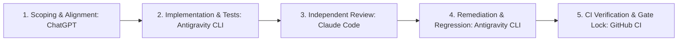

# ROADMAP.md: 13-Phase Master Development Roadmap

**Status:** PROPOSED (Phase 0 Architecture Revision 2)  
**Governing Rule:** No application or runtime implementation until `SPEC.md`, `ARCHITECTURE.md`, and `ROADMAP.md` are jointly approved and locked.  
**Planning Target:** 340 meaningful commits across 13 phases (acceptable range: 300–350 commits). *340 is a target, not a quota.*

---

## 1. Master Commit Allocation & Milestones

| Phase | Focus Area | Target Commits | Cumulative Commits | Milestone / Release Gate |
|---|---|:---:|:---:|---|
| **Phase 0** | Foundation, Specs, Package Setup | 16 | 16 | Project skeleton & approved specs |
| **Phase 1** | Core Runtime & Lifecycle | 30 | 46 | FSM execution & budget bounds |
| **Phase 2** | Memory Model & Storage Abstractions | 34 | 80 | Unified SQLite WAL persistence |
| **Phase 3** | Retrieval, Ranking, Context Compiler | 34 | 114 | Multi-signal ranker & fenced context |
| **Phase 4** | Memory Writes, Consolidation, Forgetting | 30 | 144 | Quarantined writes & verifiable deletion |
| **Phase 5** | Tool Runtime & Routing | 26 | 170 | **v0.1.0 (Core Lifecycle MVP)** |
| **Phase 6** | Checkpointing, Resume, Rollback, Branching | 26 | 196 | **v0.2.0 (Continuity & Recovery)** |
| **Phase 7** | Tracing, Provenance, Event Model | 28 | 224 | Lineage graph & PII redaction |
| **Phase 8** | Replay & Deterministic Hooks | 24 | 248 | **v0.3.0 (Governance & Replay)** |
| **Phase 9** | Evaluation Framework & Metrics | 26 | 274 | 3-baseline comparison runner |
| **Phase 10** | Benchmarks & Regression Suites | 22 | 296 | **v0.4.0 (Evaluation & Benchmarks)** |
| **Phase 11** | Integrations & Realistic Demos | 20 | 316 | 3 runnable end-to-end scenarios |
| **Phase 12** | Hardening, Docs, Packaging, Release | 24 | 340 | **v1.0.0 (Production Hardened)** |
| **Total** | | **340** | | |

---

## 2. Accounting of Existing Commits & Phase 0 Remaining Plan

### 2.1 Existing Pushed Commits (3 of 16)
The following 3 commits are already published on `origin/main` and count toward the Phase 0 total:
1. `9535535`: `docs: add draft spec specification`
2. `45b66c8`: `docs: add draft architecture specification`
3. `96d59df`: `docs: add draft roadmap specification`

### 2.2 Remaining Phase 0 Task List (13 Commits, 1 Commit per Task)
The remaining 13 commits in Phase 0 complete foundational scaffolding and packaging without implementing runtime code:

- **Commit 04 (Task 0.4):** Update and reconcile [SPEC.md](file:///Users/apple/Projects/memory-aware-agent-harness/SPEC.md) with complete FSM states vs. operations, unified storage contracts, and retention rules.
- **Commit 05 (Task 0.5):** Update and reconcile [ARCHITECTURE.md](file:///Users/apple/Projects/memory-aware-agent-harness/ARCHITECTURE.md) with deep immutability, fallible compensation, and SQLite DDL.
- **Commit 06 (Task 0.6):** Update and reconcile [ROADMAP.md](file:///Users/apple/Projects/memory-aware-agent-harness/ROADMAP.md) with 13 phases, commit cadence, and release definitions.
- **Commit 07 (Task 0.7):** Add Architecture Decision Records (ADR-001 through ADR-010) to `docs/adr/`.
- **Commit 08 (Task 0.8):** Add comprehensive Threat Model and Security Specifications to `docs/security.md`.
- **Commit 09 (Task 0.9):** Create initial `pyproject.toml` with project metadata, dependencies, and tool configs (Ruff, Mypy, Pytest).
- **Commit 10 (Task 0.10):** Add Ruff linting and formatting configuration and pre-commit hooks.
- **Commit 11 (Task 0.11):** Add strict Mypy type-checking configuration (`mypy.ini` or `pyproject.toml`).
- **Commit 12 (Task 0.12):** Create source package skeleton `src/memory_aware_agent_harness/__init__.py` with package version.
- **Commit 13 (Task 0.13):** Create public typing contracts stub `src/memory_aware_agent_harness/contracts.py`.
- **Commit 14 (Task 0.14):** Set up Pytest test directory layout and basic test fixtures in `tests/conftest.py`.
- **Commit 15 (Task 0.15):** Add GitHub Actions CI workflow `.github/workflows/ci.yml` for linting, typing, and smoke tests.
- **Commit 16 (Task 0.16):** Execute package build and installation smoke verification, document Phase 0 completion report, and lock architecture.

---

## 3. Mandatory Development & Governance Workflow

Every phase follows a strict 5-stage collaborative governance lifecycle:

1. **Scoping & Alignment (ChatGPT):** Confirm specific tasks, update acceptance criteria, and approve design changes for the phase.
2. **Implementation & Tests (Antigravity CLI):** Implement code **one coherent task per commit**. Write substantive unit, integration, and failure tests.
3. **Independent Review (Claude Code):** Perform comprehensive architectural, security, correctness, and maintainability audit. Output ranked findings (Critical, High, Medium, Low).
4. **Remediation & Regression (Antigravity CLI):** Fix all verified findings and implement explicit regression tests.
5. **CI Verification & Phase Lock (GitHub CI):** Run lint, type check, test suite, and build checks. Close and tag phase only when 100% green.

---

## 4. Git Commit & Push Rules

### 4.1 Commit Rules
- **One completed coherent task = one commit.**
- Never combine unrelated tasks; never artificially split tasks to pad commit counts.
- Commit message format: `<type>(<scope>): <concise description>` (e.g., `feat(runtime): implement FSM state transition table`).
- Commit locally after every completed task.
- Validate the task (lint, type check, test) before committing.
- Do not include agent co-author trailers or tool branding in commit metadata.

### 4.2 Push Rules
- **Push to GitHub only after the entire phase is completed and validated.**
- All quality checks (Ruff, strict Mypy, Pytest, build smoke tests, Claude Code review) must be 100% green before pushing.
- No unresolved Critical or High review findings permitted at push time.
- If GitHub CI fails after pushing, fix failures through additional task-scoped commits and report the phase as incomplete until green.

---

## 5. Testing Methodology & Quality Standards

By project completion (Phase 12), the test suite must satisfy:
- **Planning Expectation:** 200–300 substantive tests minimum.
- **Substantive Test Rule:** Tests must evaluate real functional logic, boundary limits, and failure modes. Zero dummy or empty test assertions.
- **Failure Path & Edge Case Coverage:**
  - Database locks, corrupted files, and transaction rollbacks.
  - Step, token, and wall-clock budget exhaustion.
  - Model timeout, malformed JSON, and unexpected finish reasons.
  - Tool execution exceptions, schema mismatches, and timeouts.
  - Prompt injection attacks embedded in retrieved memory records.
  - Cross-namespace isolation attacks (verifying 0% data leakage).
  - Verifiable forgetting compliance (verifying 0% retrieval of deleted/expired items).
  - Dirty rollback detection and fallible compensation failures.
- **Zero-API-Key Offline Testing:** Core test suites must run completely offline without external network calls or paid LLM API keys using deterministic test doubles.

---

## 6. Benchmark Methodology & Baselines

### 6.1 Three-Condition Comparative Evaluation
Every benchmark suite evaluates the agent across three explicit configurations using identical task fixtures:
1. **Stateless Agent (Baseline 1):** Operates with zero memory across steps and sessions.
2. **Retrieval-Only RAG Agent (Baseline 2):** Queries a keyword/vector store at step start and pastes raw chunks directly into context; no candidate validation, consolidation, or forgetting.
3. **Memory-Aware Harness (Condition 3):** Full lifecycle harness with four-tier memory, budgeted context manifest, quarantined writes, consolidation, and verifiable forgetting.

### 6.2 Standardized Benchmark Scenarios
- **Scenario A (Cross-Session Continuity):** Multi-session user preference and project state continuity across session restarts.
- **Scenario B (Crash Recovery & Idempotency):** Simulating process termination during tool dispatch; verifying safe rehydration without repeated side effects.
- **Scenario C (Privacy & Forgetting Compliance):** Measuring compliance with GDPR-style deletion requests; asserting 0% retrieval of purged information while preserving non-deleted memory.

### 6.3 Measured Metrics & Statistical Reporting
- **Task Success Rate:** Percentage of benchmark tasks achieved.
- **Stale Memory Selection Rate:** Target **0.0%**.
- **Forgetting Compliance Rate:** Target **0.0%** retrieval of deleted items.
- **Provenance Completeness:** Target **100.0%**.
- **Context Efficiency:** Percentage reduction in token bloat vs. Baseline 2.
- **Step Latency (p50, p95):** SQLite lifecycle overhead in milliseconds.
- **Reporting Rule:** Raw execution logs, variances, and negative results must be reported honestly. No claiming general superiority without empirical evidence.

---

## 7. Intermediate Milestones & Release Acceptance Criteria

### Milestone 1: v0.1.0 (Core Lifecycle MVP) — End of Phase 5
- **Scope:** Bounded FSM runtime, 4-tier memory models, unified SQLite WAL storage, multi-signal retrieval, context compiler, sandboxed tool runtime, trace exporter, and deterministic test doubles.
- **Acceptance Gate:**
  - Passes Ruff, strict Mypy, Pytest.
  - Package installs via `pip install .` and CLI smoke test passes.
  - Documented as an **early experimental milestone**, not production-ready.

### Milestone 2: v0.2.0 (Continuity & Recovery) — End of Phase 6
- **Scope:** Checkpoint snapshots, resume protocol, branch DAG, side-effect boundary audit, dirty rollback flags, and fallible compensation hooks.
- **Acceptance Gate:**
  - Crash-recovery matrix tests pass across all step boundaries.
  - Rollback past non-idempotent tools flags `PARTIAL_DIRTY_ROLLBACK` and never silently re-executes.

### Milestone 3: v0.3.0 (Governance & Replay) — End of Phase 8
- **Scope:** Candidate quarantine, episodic-to-semantic consolidation, lineage graphs, verifiable tombstone deletion, TTL expiry, and deterministic replay engine.
- **Acceptance Gate:**
  - 0.0% retrieval of deleted/expired items in forgetting compliance tests.
  - 100% bit-for-bit trajectory replay fidelity using recorded traces and test doubles.

### Milestone 4: v0.4.0 (Evaluation & Benchmarks) — End of Phase 10
- **Scope:** 3-baseline comparative evaluation runner, 3 frozen benchmark task suites, and automated statistical reporting.
- **Acceptance Gate:**
  - Benchmark suites execute completely offline without API keys.
  - Reports disclose raw logs, confidence intervals, and limitations.

### Milestone 5: v1.0.0 (Production Hardened Release) — End of Phase 12
- **Scope:** Hardened public API, backward compatibility migrations, security audit, 3 production demos, full documentation, packaging distribution, CI matrix across Python 3.11/3.12/3.13.
- **Acceptance Gate:**
  - 200–300 substantive tests passing with 100% green status.
  - Zero unresolved Critical or High findings in Claude Code independent review.
  - Demonstrable API stability and documented limitations.

---

## 8. Comprehensive Risk Register

| Risk ID | Category | Description | Severity | Likelihood | Mitigation Strategy |
|---|---|---|:---:|:---:|---|
| **RSK-01** | Architecture | Naive rollback accidentally repeats destructive external tool calls. | **Critical** | Medium | Separate internal state from external side effects; flag dirty rollbacks; require compensation hooks. |
| **RSK-02** | Security | Memory retrieval injects adversarial instructions into prompt. | **High** | Medium | Structural untrusted content fencing (`<untrusted_memory>`); explicit system instruction insulation; memory never authorizes tools. |
| **RSK-03** | Data Hygiene | Unbounded memory growth degrades retrieval quality and increases latency. | **High** | High | Phase 4 consolidation engine; LRU/decay pruning; TTL expiry; hard capacity thresholds. |
| **RSK-04** | Compliance | Deleted memories resurface in retrieval due to caching or loose queries. | **Critical** | Low | SQL-level tombstone exclusion invariant; automated forgetting compliance regression tests. |
| **RSK-05** | Reliability | Harness crashes mid-step leaving database or tool state corrupted. | **High** | Medium | SQLite WAL transactions; atomic multi-table commits; `OUTCOME_UNKNOWN` state for unresolved tool calls. |
| **RSK-06** | Testing | Test suite flakiness due to non-deterministic external LLMs or APIs. | **High** | High | First-class deterministic test doubles (`FakeModelAdapter`, `DeterministicClock`, `SeedableRNG`); zero live API calls in CI. |
| **RSK-07** | Scope | Project scope expands into distributed multi-agent swarm framework. | **Medium** | Medium | Strict adherence to Non-Goals in [SPEC.md](file:///Users/apple/Projects/memory-aware-agent-harness/SPEC.md); single-agent, single-process focus. |
| **RSK-08** | Packaging | Packaging deferred to project end results in last-minute dependency conflicts. | **Medium** | High | Introduce minimal `pyproject.toml`, linters, and smoke CI in Phase 0 (Task 0.9). |

---

## 9. Pre-Implementation Decision Lock Checklist

Before closing Phase 0 and initiating Phase 1 implementation commits, the following must be formally verified and approved:

- [ ] Core thesis and empirical hypothesis accepted ([SPEC.md](file:///Users/apple/Projects/memory-aware-agent-harness/SPEC.md)).
- [ ] Four behavioral memory categories in unified SQLite schema accepted.
- [ ] Explicit Run States vs. Step Operations FSM accepted.
- [ ] Distinguish runtime rollback from fallible external compensation accepted.
- [ ] 13-phase roadmap with 340-commit target cadence accepted ([ROADMAP.md](file:///Users/apple/Projects/memory-aware-agent-harness/ROADMAP.md)).
- [ ] Accounting of 3 existing commits + 13 remaining Phase 0 tasks accepted.
- [ ] Strict quality gates (Python 3.11+, strict mypy, ruff, 200–300 tests) accepted.
- [ ] Zero-API-key testing and benchmark requirement accepted.
- [ ] Intermediate release gates (`v0.1.0` to `v1.0.0`) accepted.
- [ ] 5-stage collaborative workflow (ChatGPT / Antigravity / Claude Code / CI) accepted.
- [ ] Architecture documents jointly approved and locked.