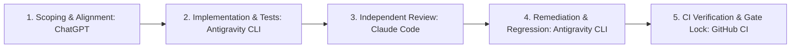

# ROADMAP.md: 13-Phase Master Development Roadmap

**Status:** REVISED (Phase 0 Independent Review Remediation Round 2)  
**Governing Rule:** No application or runtime implementation until `SPEC.md`, `ARCHITECTURE.md`, and `ROADMAP.md` are jointly approved and locked.  
**Planning Target:** 340 meaningful commits across 13 phases (agreed planning range: 300–350 commits). *Target, not an artificial quota.*

---

## 1. Master Commit Allocation & Milestones

| Phase | Focus Area | Target Commits | Cumulative Commits | Milestone / Release Gate |
|---|---|:---:|:---:|---|
| **Phase 0** | Foundation, Specs, Package Setup & Remediation | 35 | 35 | Project skeleton, typed contracts, & approved specs |
| **Phase 1** | Core Runtime & Lifecycle | 26 | 61 | Core Single-Agent Runtime Baseline (`v0.1.0.dev0`) |
| **Phase 2** | Memory Model & Storage Abstractions | 31 | 92 | Unified SQLite WAL persistence |
| **Phase 3** | Retrieval, Ranking, Context Compiler | 31 | 123 | Multi-signal ranker & fenced context |
| **Phase 4** | Memory Writes, Consolidation, Forgetting | 28 | 151 | Quarantined writes & verifiable deletion |
| **Phase 5** | Tool Runtime & Routing | 25 | 176 | **v0.1.0 (Core Lifecycle MVP)** |
| **Phase 6** | Checkpointing, Resume, Rollback, Branching | 25 | 201 | **v0.2.0 (Continuity & Recovery)** |
| **Phase 7** | Tracing, Provenance, Event Model | 26 | 227 | Lineage graph & PII redaction |
| **Phase 8** | Replay & Deterministic Hooks | 24 | 251 | **v0.3.0 (Governance & Replay)** |
| **Phase 9** | Evaluation Framework & Metrics | 25 | 276 | 3-baseline comparison runner |
| **Phase 10** | Benchmarks & Regression Suites | 22 | 298 | **v0.4.0 (Evaluation & Benchmarks)** |
| **Phase 11** | Integrations & Realistic Demos | 20 | 318 | 3 runnable end-to-end scenarios |
| **Phase 12** | Hardening, Docs, Packaging, Release | 22 | 340 | **v1.0.0 (Production Hardened)** |
| **Total** | | **340** | | |

---

## 2. Accounting of Phase 0 Commits

### 2.1 Baseline Phase 0 Commits (Commits 1 to 17)
The following 17 baseline commits established the Phase 0 foundation up to published commit `66481a9`:
1. `9535535`: `docs: add draft spec specification`
2. `45b66c8`: `docs: add draft architecture specification`
3. `96d59df`: `docs: add draft roadmap specification`
4. `78528bc`: `docs(spec): reconcile execution FSM, unified storage, and retention boundaries`
5. `a98153b`: `docs(architecture): specify deep immutability, fallible compensation, and SQLite WAL schema`
6. `0cf28f0`: `docs(roadmap): expand 13-phase master plan with commit allocation and release gates`
7. `9836f57`: `docs(adr): add architecture decision records ADR-0001 through ADR-0010`
8. `837b8cb`: `docs(security): establish security architecture, threat model, and untrusted boundaries`
9. `818bdf2`: `build: create initial pyproject.toml and project metadata`
10. `d82d327`: `chore(lint): configure ruff linting, formatting, and pre-commit hooks`
11. `9752316`: `chore(types): configure strict mypy static type checking`
12. `e69b19e`: `init(pkg): create package skeleton and version declaration`
13. `6001e12`: `feat(contracts): define public types, immutable data models, exceptions, and ports`
14. `5c39352`: `test(fixtures): establish test directory structure, fixtures, and contracts smoke tests`
15. `816f696`: `ci: add github actions workflow for linting, typing, testing, and packaging`
16. `dd93549`: `build(verify): validate package build, packaging smoke tests, and Phase 0 report`
17. `66481a9`: `ci(fix): scope ruff checks to src and tests and synchronize architecture code block`

### 2.2 Independent Review Remediation Round 1 Commits (Commits 18 to 28)
Addressing Claude Code independent architecture review findings (H-01 through H-07, and Medium findings):
18. `fa11fd1`: `fix(contracts): add NewType identifiers, CandidateStatus, and validation rules` (M-01 through M-05)
19. `608046a`: `feat(contracts): implement deep immutability, normalization, and serialization` (H-01 initial attempt)
20. `5a85a4d`: `feat(contracts): define FSM states, transition matrix, and execution contexts` (H-02, H-03, H-04)
21. `3d02e60`: `feat(replay): add deterministic test doubles for clock and id generator` (H-03 deterministic doubles)
22. `7e7457d`: `docs(spec): reconcile rollback semantics, erasure propagation, and threat model` (H-05, H-06, H-07)
23. `4577952`: `docs(architecture): update FSM, step commit protocol, and prune duplicate code` (H-02, H-04, H-05, M-06)
24. `1a27416`: `docs(roadmap): update Phase 0 remediation accounting and milestone gates` (M-11)
25. `cb4c4da`: `chore(license): add Apache-2.0 license and fix packaging metadata` (M-07)
26. `98b414f`: `chore(ci): align ruff configuration and add wheel installation smoke test` (M-08, M-09)
27. `dcf1ebe`: `test(remediation): add comprehensive negative-path and failure test suite` (M-10)
28. `8deb860`: `docs(report): compile independent review remediation matrix and validation evidence` (Round 1 report)

### 2.3 Independent Review Remediation Round 2 Commits (Commits 29 to 35)
Targeted remediation following independent reproduction of H-01, H-03, and N-01:
29. `a2b751b`: `fix(contracts): replace MappingProxyType with FrozenDict and harden serialization` (H-01 complete fix: hash, deepcopy, pickle, asdict, UTC equivalence, NaN/Inf and invalid metadata rejection)
30. `12d05b6`: `feat(contracts): require execution contexts, integrate token usage and failure details` (H-03 complete fix: mandatory contexts, cancellation/deadline semantics, TokenUsage/FailureDetails integration, structured exception fields)
31. `fef9606`: `docs(remediation): reconcile git commit history and audit matrix for review round 2` (N-01 complete fix: git log synchronization, finding classifications, roadmap 300–350 reconciliation)
32. `3172866`: `docs(remediation): reconcile audit matrix with full finding taxonomy and residual items` (Matrix finding taxonomy reconciliation: full Claude finding catalog, explicit statuses, commit citations, technical limits)
33. `a7c3f4b`: `docs(architecture): reconcile FSM diagrams, durability, erasure, and security boundaries` (Architecture, security, and ADR reconciliation: FSM legal transitions, SQLite secure_delete, durability trade-offs, SSD wear-leveling)
34. `4083de7`: `docs(roadmap): reconcile commit history, traceability, and Phase 0 report` (Roadmap traceability and Phase 0 report synchronization across all 34 commits)
35. `320c12a`: `docs(remediation): reconcile original finding taxonomy, residual items, and schema safeguards` (Final Phase 0 evidence reconciliation: original finding IDs, honest statuses, schema safeguards, anti-resurrection)

### 2.5 Accounting of Phase 1 Commits (Commits 36 to 61)
The following 26 commits delivered the operational core single-agent runtime:
- **Batch A: Contracts & Engineering Foundation (Commits 36 to 43):**
  36. `d60ab95`: `fix(contracts): enforce serializable metadata roundtripping and strict primitive validation` (R-1 closed)
  37. `ebc452a`: `fix(contracts): harden FrozenDict against inherited dict mutation bypasses` (R-2 closed)
  38. `1782dfc`: `feat(runtime): introduce live cancellation token for in-progress execution (R-3)` (R-3 closed)
  39. `d2fbd36`: `fix(contracts): enforce consistent token accounting and structured failure invariants (R-4)` (R-4 closed)
  40. `6627255`: `fix(contracts): enforce strict enum validation and reject lossy primitive coercion (M-03)` (M-03 closed)
  41. `5884c35`: `feat(validation): implement Pydantic v2 boundary validation without duplicate models`
  42. `1283d1b`: `chore(ci): align exact ruff version requirement and enforce repository-wide lint checks (M-06)` (M-06 closed)
  43. `7550ad6`: `chore(packaging): validate sdist and wheel installation compatibility in CI (M-11)` (M-11 closed)
- **Batch B: Core Runtime FSM & Lifecycle Controller (Commits 44 to 51):**
  44. `23b36a3`: `feat(runtime): implement RunFSM and StepFSM with legal transition validation` (H-02 engine)
  45. `62bb0a3`: `feat(runtime): implement LifecycleState container tracking run and step lifecycles`
  46. `18f6391`: `feat(runtime): implement budget exhaustion guards for step, token, and time limits`
  47. `25e4dfa`: `feat(runtime): implement live cancellation listener and abort dispatcher`
  48. `11c9d4c`: `feat(runtime): implement orphaned-run recovery handler and crash reconciliation`
  49. `0ef023a`: `feat(runtime): implement step outcome compiler with monotonic token accounting`
  50. `236ff89`: `feat(runtime): implement terminal RunResult builder enforcing outcome invariants`
  51. `75796e4`: `test(runtime): add comprehensive unit and failure tests for runtime FSM and lifecycle transitions`
- **Batch C: Deterministic Agent Loop & Model Adapter (Commits 52 to 57):**
  52. `428b2c1`: `feat(runtime): implement FakeModelAdapter for deterministic offline execution`
  53. `88d7916`: `feat(runtime): implement AgentRuntime bounded execution loop runner`
  54. `a3a1029`: `feat(runtime): wire complete 8-phase step lifecycle sequence in AgentRuntime`
  55. `95c9231`: `feat(runtime): add cooperative cancellation checkpoints throughout execution loop`
  56. `0475ca4`: `feat(runtime): add diagnostic hooks and lifecycle event emission`
  57. `b794822`: `test(runtime): add end-to-end deterministic execution loop tests with FakeModelAdapter`
- **Batch D: Quality Gates, CLI Demo & Documentation (Commits 58 to 61):**
  58. `5b9b0ee`: `test(runtime): validate >=85% branch coverage across all runtime modules` (M-07 closed)
  59. `b9a360b`: `feat(cli): implement runnable offline demo CLI`
  60. `30c850b`: `docs(remediation): update remediation matrix and Phase 1 roadmap status`
  61. `6b62ee7`: `chore(release): lock Phase 1 milestone deliverables`

### 2.5.1 Phase 1 Independent Audit Remediation Commits (Commits 62 to 67)
Targeted remediation following independent review findings (P1-H1, P1-H2, P1-M1 through P1-M6, R-2, M-06, M-07, M-11):
- 62. `1aec737`: `fix(contracts): implement FrozenDict via collections.abc.Mapping encapsulation (R-2)`
- 63. `ac2830f`: `fix(runtime): enforce pre-execution validation and duplicate tool rejection (P1-M4)`
- 64. `65e3158`: `feat(runtime): feed tool observations, enforce strict budgets, and refactor step loop (P1-H1, P1-H2, P1-M1, P1-M2)`
- 65. `de2fd44`: `fix(events): ensure strict diagnostic listener failure consistency (P1-M5)`
- 66. `617f5d5`: `build(ci): pin Ruff 0.9.9 and verify wheel-installed testing (M-06, M-07, M-11)`
- 67. `HEAD`: `docs(remediation): reconcile Phase 1 audit findings, cancellation limits, and roadmap milestone ownership (P1-M3, P1-M6)`

### 2.6 Deferred Findings & Future Phase Traceability
All runtime implementation requirements and findings deferred from Phase 0 and Phase 1 are strictly tracked against their scheduled implementation phases:
- **Phase 1 (Core Runtime & Lifecycle) — COMPLETE (Baseline at `v0.1.0.dev0`):**
  - **P1-H1:** Bounded structured execution history prompt compilation feeding prior model decisions and tool observations back to subsequent model calls (RESOLVED).
  - **P1-H2:** Strict token and time budget bounds enforcement before/after calls; 100x and wall-clock overruns halt with `BUDGET_EXHAUSTED`, never `COMPLETED`; deadlines passed through contexts (RESOLVED).
  - **P1-M1:** Immediate token recording upon model return across all execution branches including errors (RESOLVED).
  - **P1-M2:** Mutating tool failure records `OUTCOME_UNKNOWN` with side-effect uncertainty; `RunResult` exposes `step_history` and `tool_results` summaries (RESOLVED).
  - **P1-M3:** Cooperative cancellation limitations explicitly documented: cancellation is evaluated at phase/checkpoint boundaries and adapter polling; uninterruptible blocking I/O cannot be pre-empted until control yields back to Python (RESOLVED).
  - **P1-M4:** Pre-execution validation of task, namespace, budgets, cancellation tokens, and duplicate tool names (RESOLVED).
  - **P1-M5:** Diagnostic listener error consistency: strict mode raises `DiagnosticListenerError` and guarantees callers receive a structured terminal `RunResult` (RESOLVED).
  - **P1-M6:** Milestone ownership corrected: Phase 1 is `v0.1.0.dev0` baseline; Phase 5 owns `v0.1.0 (Core Lifecycle MVP)` (RESOLVED).
  - **R-1:** Metadata round-trip validation and normalization across nested structures (RESOLVED).
  - **R-2:** Deep immutability hardening for `FrozenDict` via `collections.abc.Mapping` encapsulation (RESOLVED).
  - **R-3:** Live cooperative cancellation signaling via `threading.Event` and abort dispatch (RESOLVED).
  - **R-4:** Monotonic token accounting and mandatory failure detail enforcement (RESOLVED).
  - **M-03:** Runtime input validation, enum coercion, and Pydantic v2 boundary validation (RESOLVED).
  - **M-06:** Pinned Ruff linter version (`0.9.9`) across CI, development dependencies, and pre-commit (RESOLVED).
  - **M-07:** Substantive test coverage gate ($\ge 85\%$ branch coverage enforced across all modules) and wheel-installed testing in CI (RESOLVED).
  - **M-11:** Setuptools packaging compatibility matrix (`setuptools>=70.0.0`, `wheel>=0.40.0`), isolated and no-isolation builds, and runnable entrypoint (RESOLVED).
  - **H-02:** Runtime FSM execution engine, step lifecycle execution, transition validation, `RunBudgets` enforcement, orphaned-run recovery, and cancellation/timeout handling (RESOLVED).
  - **Architectural Scope Boundaries:** Step loop phases 5–7 (memory extraction, memory commit, and durable checkpointing) are structured architectural extension points with lifecycle events, not implemented persistence; orphaned-run recovery is in-process memory state reconciliation (persistent SQLite recovery scheduled for Phase 2).
- **Phase 2 (Memory Model & Storage Abstractions):**
  - **M-04:** Scored retrieval and deterministic storage interfaces (`MemoryStoreProtocol` scoring, deterministic time, versioning, and lifecycle operations).
  - **M-05:** Storage scoping across run, branch, namespace, and provenance (`namespace_id`, `run_id`, `branch_id`, and `origin` scoping; direct `namespace_id` columns on child tables `checkpoints` and `trace_events`).
  - **Checkpoint & Trace Erasure Obligations & Restoration Safeguards:** Cascading purge of historical checkpoints referencing deleted runs; trace event payload compaction based on `retention_days`; **Tombstone Reconciliation** during checkpoint restoration to prevent resurrecting erased memories.
  - **M-08:** SQLite storage schema allocation for schema versions, state hashes, and integrity constraints.
  - **M-09:** Redaction pipeline execution before storage persistence (preventing credential leakage into SQLite WAL).
  - **H-04:** Physical SQLite persistence transaction manager, 4-phase step commit protocol (`INTENT_RECORDED` $\rightarrow$ `TOOL_DISPATCH` $\rightarrow$ `OUTCOME_UPDATE` $\rightarrow$ `ATOMIC_STEP_COMMIT`), WAL file durability (`synchronous = NORMAL/FULL`), and `UNIQUE(namespace_id, tool_name, idempotency_key)` uniqueness constraints.
- **Phase 3 (Retrieval, Ranking, Context Compiler):**
  - **H-07:** Fenced prompt compiler with mandatory XML entity escaping (`&lt;`, `&gt;`, `&amp;`, `&quot;`, `&apos;`) for untrusted memory content; 5-class `MemoryOrigin` provenance boundary enforcement; token budget allocation for context compilation.
  - Multi-signal retrieval scoring ($w_{rel}, w_{rec}, w_{sal}, w_{freq}, P_{decay}$).
- **Phase 4 (Memory Writes, Consolidation, Forgetting):**
  - **H-06:** Multi-boundary verifiable forgetting engine; physical software deletion (`PRAGMA secure_delete = ON; DELETE; wal_checkpoint(TRUNCATE)`); lineage propagation marking derived memories as `origin_status = 'ORIGIN_PURGED'`; durable tombstones.
  - Memory candidate quarantine and explicit write policy evaluation; episodic-to-semantic consolidation pipelines.
- **Phase 5 (Tool Runtime & Routing):**
  - Sandboxed tool dispatcher and Pydantic v2 argument validation.
  - Durable tool invocation intent registration (`status = 'pending'`).
  - Idempotency uniqueness checking and crash recovery handling with `OUTCOME_UNKNOWN`.
- **Phase 6 (Checkpointing, Resume, Rollback, Branching):**
  - **H-05:** State rollback semantics differentiating `CLEAN_ROLLBACK` (for `READ_ONLY`) from `PARTIAL_DIRTY_ROLLBACK` (for `IDEMPOTENT_WRITE` and `NON_IDEMPOTENT_WRITE`); fallible side-effect compensation execution; branch DAG isolation via `branch_id`.
- **Phase 7 (Tracing, Provenance, Event Model):**
  - **M-09:** Full automated PII/secret redactor module and append-only trace log.
  - JSONL exporter and deterministic SHA-256 state hashing across transitions for replay divergence detection.
- **Phase 8 (Replay & Deterministic Hooks):**
  - **M-08:** Deterministic replay engine, trace replayer, schema version compatibility validation, and bit-for-bit replay verification with deterministic doubles.
- **Phase 9 (Evaluation Framework & Metrics):**
  - **M-10:** 3-baseline comparative evaluation runner (Stateless, Naive RAG, Memory-Aware) with meaningful baselines against existing memory-enabled agent architectures.
- **Phase 10 (Benchmarks & Regression Suites):**
  - Reproducible offline benchmark suites, long-horizon memory retention benchmarks, and statistical reporting.
- **Phase 11 (Integrations & Realistic Demos):**
  - Three runnable end-to-end production scenarios and model/tool adapters.
- **Phase 12 (Hardening, Docs, Packaging, Release):**
  - Cryptographic HMAC state authentication for tamper detection, schema migration verification, security audit, and packaging distribution freeze.

> [!NOTE]
> **Implementation Status:** Work on Phases 1 through 12 is explicitly unstarted. Phase 0 contains exclusively contracts, deterministic test doubles, packaging, and validation scaffolding.

---

## 3. Mandatory Development & Governance Workflow

Every phase follows a strict 5-stage collaborative governance lifecycle:

1. **Scoping & Alignment (ChatGPT):** Confirm specific tasks, update acceptance criteria, and approve design changes for the phase.
2. **Implementation & Tests (Antigravity CLI):** Implement code **one coherent task per commit**. Write substantive unit, integration, and failure tests.
3. **Independent Review (Claude Code):** Perform comprehensive architectural, security, correctness, and maintainability audit. Output ranked findings (Critical, High, Medium, Low).
4. **Remediation & Regression (Antigravity CLI):** Fix all verified findings and implement explicit regression tests.
5. **CI Verification & Phase Lock (GitHub CI):** Run lint, type check, test suite, and build checks. Close and tag phase only when 100% green.

---

## 4. Git Commit & Push Rules

### 4.1 Commit Rules
- **One completed coherent task = one commit.**
- Never combine unrelated tasks; never artificially split tasks to pad commit counts.
- Commit message format: `<type>(<scope>): <concise description>` (e.g., `feat(runtime): implement FSM state transition table`).
- Commit locally after every completed task.
- Validate the task (lint, type check, test) before committing.
- Do not include agent co-author trailers or tool branding in commit metadata.

### 4.2 Push Rules
- **Push to GitHub only after the entire phase is completed and validated.**
- All quality checks (Ruff, strict Mypy, Pytest, build smoke tests, Claude Code review) must be 100% green before pushing.
- No unresolved Critical or High review findings permitted at push time.
- If GitHub CI fails after pushing, fix failures through additional task-scoped commits and report the phase as incomplete until green.

---

## 5. Testing Methodology & Quality Standards

By project completion (Phase 12), the test suite must satisfy:
- **Planning Expectation:** 200–300 substantive tests minimum.
- **Substantive Test Rule:** Tests must evaluate real functional logic, boundary limits, and failure modes. Zero dummy or empty test assertions.
- **Failure Path & Edge Case Coverage:**
  - Database locks, corrupted files, and transaction rollbacks.
  - Step, token, and wall-clock budget exhaustion.
  - Model timeout, malformed JSON, and unexpected finish reasons.
  - Tool execution exceptions, schema mismatches, and timeouts.
  - Prompt injection attacks embedded in retrieved memory records.
  - Cross-namespace isolation attacks (verifying 0% data leakage).
  - Verifiable forgetting compliance (verifying 0% retrieval of deleted/expired items).
  - Dirty rollback detection and fallible compensation failures.
- **Zero-API-Key Offline Testing:** Core test suites must run completely offline without external network calls or paid LLM API keys using deterministic test doubles.

---

## 6. Benchmark Methodology & Baselines

### 6.1 Three-Condition Comparative Evaluation
Every benchmark suite evaluates the agent across three explicit configurations using identical task fixtures:
1. **Stateless Agent (Baseline 1):** Operates with zero memory across steps and sessions.
2. **Retrieval-Only RAG Agent (Baseline 2):** Queries a keyword/vector store at step start and pastes raw chunks directly into context; no candidate validation, consolidation, or forgetting.
3. **Memory-Aware Harness (Condition 3):** Full lifecycle harness with four-tier memory, budgeted context manifest, quarantined writes, consolidation, and verifiable forgetting.

### 6.2 Standardized Benchmark Scenarios
- **Scenario A (Cross-Session Continuity):** Multi-session user preference and project state continuity across session restarts.
- **Scenario B (Crash Recovery & Idempotency):** Simulating process termination during tool dispatch; verifying safe rehydration without repeated side effects.
- **Scenario C (Privacy & Forgetting Compliance):** Measuring compliance with GDPR-style deletion requests; asserting 0% retrieval of purged information while preserving non-deleted memory.

### 6.3 Measured Metrics & Statistical Reporting
- **Task Success Rate:** Percentage of benchmark tasks achieved.
- **Stale Memory Selection Rate:** Target **0.0%**.
- **Forgetting Compliance Rate:** Target **0.0%** retrieval of deleted items.
- **Provenance Completeness:** Target **100.0%**.
- **Context Efficiency:** Percentage reduction in token bloat vs. Baseline 2.
- **Step Latency (p50, p95):** SQLite lifecycle overhead in milliseconds.
- **Reporting Rule:** Raw execution logs, variances, and negative results must be reported honestly. No claiming general superiority without empirical evidence.

---

## 7. Intermediate Milestones & Release Acceptance Criteria

### Milestone 1: v0.1.0 (Core Lifecycle MVP) — End of Phase 5
- **Scope:** Bounded FSM runtime, 4-tier memory models, unified SQLite WAL storage, multi-signal retrieval, context compiler, sandboxed tool runtime, trace exporter, and deterministic test doubles.
- **Acceptance Gate:**
  - Passes Ruff, strict Mypy, Pytest.
  - Package installs via `pip install .` and CLI smoke test passes.
  - Documented as an **early experimental milestone**, not production-ready.

### Milestone 2: v0.2.0 (Continuity & Recovery) — End of Phase 6
- **Scope:** Checkpoint snapshots, resume protocol, branch DAG, side-effect boundary audit, dirty rollback flags, and fallible compensation hooks.
- **Acceptance Gate:**
  - Crash-recovery matrix tests pass across all step boundaries.
  - Rollback past any mutating tools (`IDEMPOTENT_WRITE` or `NON_IDEMPOTENT_WRITE`) flags `PARTIAL_DIRTY_ROLLBACK` and never silently re-executes.
  - Branch visibility tests assert memory isolation across execution tree branches.

### Milestone 3: v0.3.0 (Governance & Replay) — End of Phase 8
- **Scope:** Candidate quarantine, episodic-to-semantic consolidation, lineage graphs, verifiable tombstone deletion, TTL expiry, and deterministic replay engine.
- **Acceptance Gate:**
  - 0.0% retrieval of deleted/expired items in forgetting compliance tests.
  - Invalidation of derived memories referencing purged records (`origin_status = 'ORIGIN_PURGED'`).
  - 100% bit-for-bit trajectory replay fidelity using recorded traces and test doubles.

### Milestone 4: v0.4.0 (Evaluation & Benchmarks) — End of Phase 10
- **Scope:** 3-baseline comparative evaluation runner, 3 frozen benchmark task suites, and automated statistical reporting.
- **Acceptance Gate:**
  - Benchmark suites execute completely offline without API keys.
  - Reports disclose raw logs, confidence intervals, and limitations.

### Milestone 5: v1.0.0 (Production Hardened Release) — End of Phase 12
- **Scope:** Hardened public API, backward compatibility migrations, security audit, 3 production demos, full documentation, packaging distribution, CI matrix across Python 3.11/3.12/3.13.
- **Acceptance Gate:**
  - 200–300 substantive tests passing with 100% green status.
  - Zero unresolved Critical or High findings in Claude Code independent review.
  - Demonstrable API stability and documented limitations.

---

## 8. Comprehensive Risk Register

| Risk ID | Category | Description | Severity | Likelihood | Mitigation Strategy |
|---|---|---|:---:|:---:|---|
| **RSK-01** | Architecture | Naive rollback accidentally repeats destructive external tool calls or assumes idempotent writes are reversible. | **Critical** | Medium | Separate internal state from external side effects; classify both idempotent and non-idempotent writes as external mutations; flag `PARTIAL_DIRTY_ROLLBACK`; execute fallible compensation. |
| **RSK-02** | Security | Memory retrieval injects adversarial instructions into prompt or breaks out of delimiters. | **High** | Medium | Structural untrusted content fencing (`<untrusted_memory>`); mandatory XML escaping of memory content (`&lt;`, `&gt;`, `&amp;`); memory trust categorization (`MemoryOrigin`). |
| **RSK-03** | Data Hygiene | Unbounded memory growth degrades retrieval quality and increases latency. | **High** | High | Phase 4 consolidation engine; LRU/decay pruning; TTL expiry; hard capacity thresholds. |
| **RSK-04** | Compliance | Deleted memories resurface in retrieval or persist in derived knowledge. | **Critical** | Low | SQL-level tombstone exclusion invariant; WAL frame truncation (`PRAGMA wal_checkpoint(TRUNCATE)`); lineage propagation to derived memories (`ORIGIN_PURGED`). |
| **RSK-05** | Reliability | Harness crashes mid-step leaving database or tool state corrupted. | **High** | Medium | SQLite WAL transactions; crash-safe two-phase step commit protocol (intent registration $\rightarrow$ dispatch $\rightarrow$ outcome update $\rightarrow$ atomic commit); `OUTCOME_UNKNOWN` handling on recovery. |
| **RSK-06** | Testing | Test suite flakiness due to non-deterministic external LLMs or APIs. | **High** | High | First-class deterministic test doubles (`FakeModelAdapter`, `DeterministicClock`, `SeedableRNG`); zero live API calls in CI. |
| **RSK-07** | Scope | Project scope expands into distributed multi-agent swarm framework. | **Medium** | Medium | Strict adherence to Non-Goals in [SPEC.md](SPEC.md); single-agent, single-process focus. |
| **RSK-08** | Packaging | Packaging deferred to project end results in last-minute dependency conflicts. | **Medium** | High | Introduce minimal `pyproject.toml`, linters, and smoke CI in Phase 0 (Task 0.9). |

---

## 9. Pre-Implementation Decision Lock Checklist

Before closing Phase 0 and initiating Phase 1 implementation commits, the following must be formally verified and approved:

- [ ] Core thesis and empirical hypothesis accepted ([SPEC.md](SPEC.md)).
- [ ] Four behavioral memory categories in unified SQLite schema accepted.
- [ ] Explicit Run States vs. Step Operations FSM accepted.
- [ ] Distinguish runtime rollback from fallible external compensation accepted.
- [ ] 13-phase roadmap with 340-commit target cadence accepted ([ROADMAP.md](ROADMAP.md)).
- [ ] Accounting of 3 existing commits + 13 remaining Phase 0 tasks accepted.
- [ ] Strict quality gates (Python 3.11+, strict mypy, ruff, 200–300 tests) accepted.
- [ ] Zero-API-key testing and benchmark requirement accepted.
- [ ] Intermediate release gates (`v0.1.0` to `v1.0.0`) accepted.
- [ ] 5-stage collaborative workflow (ChatGPT / Antigravity / Claude Code / CI) accepted.
- [ ] Architecture documents jointly approved and locked.