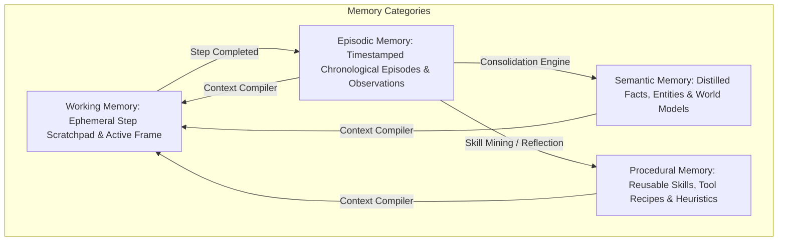
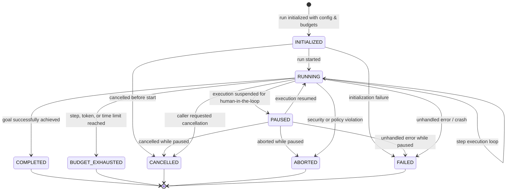
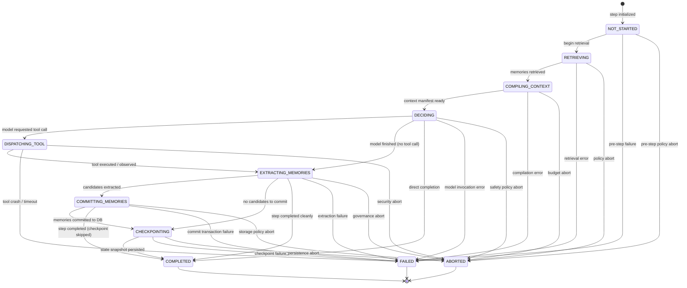
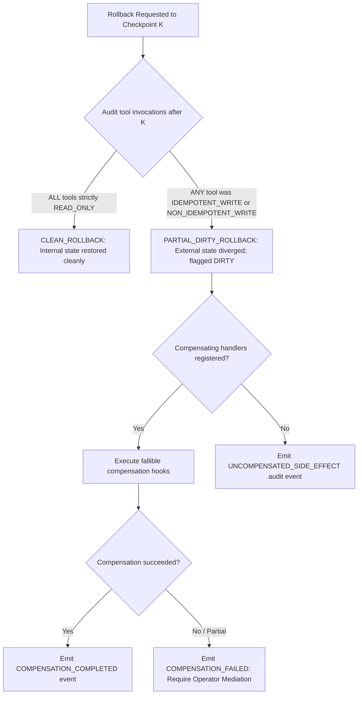

# SPEC.md: Memory-Aware Agent Harness Specification

**Project:** `aditya89bh/memory-aware-agent-harness`  
**Portfolio Layer:** Runtime Infrastructure  
**Status:** PROPOSED (Phase 0 Architecture Revision 2)  
**Specification Version:** 0.3-revised  
**Master Plan:** 13 Phases (Phases 0–12), 340 Planned Commits (300–350 Acceptable Range)

---

## 1. Executive Summary & Project Thesis

Modern autonomous AI agents frequently treat memory as a detached, external retrieval service (e.g., ad-hoc RAG over a vector store). This approach introduces critical failure modes:
1. **Decoupled Lifecycle:** The runtime does not govern *when* to retrieve, *what* is permitted into working context, or *how* observations become durable knowledge.
2. **Context Poisoning & Injection:** Untrusted tool observations and retrieved memories are mixed indiscriminately with system directives, exposing the agent to prompt injection and stale-context hallucination.
3. **Irreversible Side-Effect Hazards:** Restoring or rolling back agent state after a crash or bad turn either blindly re-executes destructive external actions or corrupts memory.
4. **Unbounded Context and Memory Drift:** Without policy-driven consolidation, eviction, and verifiable forgetting, context windows fill up with redundant, conflicting, or expired data.

### Core Thesis
**Agent memory must be a first-class component of the core execution lifecycle, not merely an external retrieval service.**

The harness governs:
- **Retrieval:** Pre-decision, policy-ranked memory retrieval scoped by strict namespace isolation.
- **Context Compilation:** Budget-capped, provenance-labeled context assembly with untrusted-data boundaries.
- **Candidate Lifecycle:** Explicit extraction, policy validation, write-authorization, and rejection tracking.
- **Governance:** Background and post-run consolidation, supersession graphs, and verifiable forgetting across all storage tiers.
- **Continuity & Replay:** Durable checkpoints, branching, replay hooks, and an explicit boundary separating internal state rollback from irreversible external side effects.

### Testable Empirical Hypothesis
On controlled, reproducible multi-session agent benchmark tasks:
> A lifecycle-integrated memory harness achieves higher task completion rates and continuity over (A) stateless agents and (B) naive retrieval-only agents, while maintaining zero cross-namespace leakage, zero selection of expired/superseded memories, verifiable 100% provenance tracking, and bounded latency/token overhead.

---

## 2. System Capabilities & Scope Boundaries

### 2.1 Required Capabilities (The 12 Pillars)
1. **Agent Execution Lifecycle:** Explicit finite state machine (FSM) governing every run and step with formal separation between states and operations.
2. **Four Behavioral Memory Categories:** Formal contracts for **Working**, **Episodic**, **Semantic**, and **Procedural** memory stored in a unified, indexed schema.
3. **Memory Storage & Retrieval Abstractions:** Typed ports for persistence (SQLite WAL reference store) and hybrid retrieval (lexical/BM25, exact, metadata, and optional vector).
4. **Retrieval Ranking & Context Compilation:** Multi-signal scoring (relevance, recency, salience, frequency, decay) and budget-allocated compilation with strict provenance manifests.
5. **Memory Writes, Consolidation & Forgetting:** Policy-driven candidate ingestion, episodic-to-semantic consolidation with lineage, and verifiable forgetting (tombstones, TTL, physical erasure).
6. **Tool Execution & Routing:** Central tool registry, argument validation via Pydantic v2, sandboxed dispatch, side-effect categorization, and idempotency key enforcement.
7. **Checkpointing, Resume, Rollback & Branching:** Durable snapshotting, state rehydration, execution tree branching, and strict differentiation between internal state rollback and irreversible side effects.
8. **Tracing, Provenance & Event Records:** Append-only structured event log, end-to-end provenance graphs, and automated secret/PII redaction.
9. **Replay & Deterministic Execution Hooks:** Reproducible replay of canonical recorded inputs and outputs under compatible schema versions using deterministic test doubles.
10. **Evaluation Framework & Metrics:** Automated evaluation engine measuring task success, precision@k, stale memory selection rate, provenance coverage, and forgetting compliance.
11. **Reproducible Benchmarks:** Standardized, offline, frozen task suites with statistical reporting (confidence intervals, ablations).
12. **Realistic End-to-End Demonstrations:** Production-grade reference scenarios illustrating cross-session continuity, crash recovery, and privacy-compliant forgetting.

### 2.2 Non-Goals
- **Universal Multi-Agent Orchestrator:** We do not replace LangGraph, AutoGen, or CrewAI. This is a focused single-agent execution harness.
- **Distributed Agent Swarms:** No multi-agent messaging buses, distributed scheduling, or cluster consensus protocols.
- **Model Training/Fine-Tuning:** No weights training; cognitive capabilities are managed at the runtime and memory layer.
- **Proprietary Vector Database Implementation:** We do not implement a custom vector indexing engine; SQLite (with optional vector extension or pure-Python cosine doubles) serves as local persistence.
- **Guaranteed External Undo:** We do not claim to magically undo external API mutations (e.g., sent emails, deleted cloud resources); compensation is fallible and cannot guarantee reversal.
- **Hosted Cloud Platform:** No SaaS multi-tenant billing, OAuth provider, or web UI dashboard.

---

## 3. Four Behavioral Memory Categories

The harness models cognitive memory into four distinct behavioral categories. Importantly, **these categories do not require four separate database tables**; they reside in a unified, indexed `memory_records` schema distinguished by a `kind` discriminator column:

### 3.1 Working Memory (WM)
- **Scope & Lifetime:** Scoped to the active execution run/step. Ephemeral by default; cleared between steps unless committed or retained in active plan frame.
- **Contents:** Current task objective, active plan/sub-goal, working hypotheses, ephemeral scratchpad, active tool outputs of the immediate turn.
- **Capacity Constraint:** Fixed token/character budget (e.g., max 2,000 tokens). Eviction follows LRU scratchpad pruning.

### 3.2 Episodic Memory (EM)
- **Scope & Lifetime:** Durable, append-only history of agent experiences across sessions within a namespace.
- **Contents:** Discrete episodes comprising user prompts, decisions taken, tools invoked, verbatim environment observations, timestamps, and execution outcomes.
- **Identity & Schema:** Immutable records keyed by `memory_id` with `kind = 'episodic'`, sequential step references, run correlation, and outcome status.

### 3.3 Semantic Memory (SM)
- **Scope & Lifetime:** Durable, mutable (versioned) knowledge base of generalized truths, user preferences, domain assertions, and entity profiles.
- **Contents:** Distilled, atomic propositions (e.g., `User prefers Python 3.11 with strict typing`), confidence scores (0.0–1.0), creation and last-accessed timestamps, validity intervals, and source lineage.
- **Lifecycle Operations:** Created via consolidation or direct extraction; updated via supersession; pruned via forgetting.

### 3.4 Procedural Memory (PM)
- **Scope & Lifetime:** Durable library of executable recipes, behavioral policies, tool combination strategies, and recovery heuristics.
- **Contents:** Skill definitions, parameterized argument recipes, preconditions, postconditions, and known failure modes (e.g., `When querying API and receiving 429, back off exponentially for 5 seconds`).

---

## 4. Execution Lifecycle: States vs. Operations

To eliminate ambiguity, the harness strictly separates **Run States** (the condition of the agent runtime) from **Lifecycle Operations** (the discrete computational stages executed during a step).

### 4.1 Formal Run States

#### Run State Taxonomy
1. **Non-Terminal States:**
   - `INITIALIZED`: Run record created, policies loaded, budgets configured. Can transition to `RUNNING`, or abort early via `CANCELLED` or `FAILED`.
   - `RUNNING`: Actively processing steps in the execution loop. Can transition to `RUNNING` (loop), `PAUSED`, or any terminal state (`COMPLETED`, `BUDGET_EXHAUSTED`, `CANCELLED`, `ABORTED`, `FAILED`).
   - `PAUSED`: Execution paused awaiting external event, human approval, or crash reconciliation. Can resume to `RUNNING`, or terminate via `CANCELLED`, `ABORTED`, or `FAILED`.
2. **Terminal States:**
   - `COMPLETED`: Agent successfully achieved its task goal or issued final response.
   - `BUDGET_EXHAUSTED`: Execution halted due to exceeding max steps, token budget, or wall-clock timeout.
   - `CANCELLED`: Execution cancelled by explicit caller or client request.
   - `ABORTED`: Execution terminated immediately due to security violation or fatal policy refusal.
   - `FAILED`: Execution terminated due to unhandled runtime exception, database failure, or crash.

### 4.2 Lifecycle Step FSM & Operations

Step execution within the `RUNNING` state is governed by a discrete state machine (`StepState`) with strict transition validation (`LEGAL_STEP_TRANSITIONS`):

#### Step Operation Sequence
During an ordinary non-terminal turn, each step advances through the ordered operations:

$$\text{RETRIEVE} \longrightarrow \text{COMPILE\_CONTEXT} \longrightarrow \text{DECIDE} \longrightarrow [\text{DISPATCH\_TOOL} \rightarrow \text{OBSERVE}] \longrightarrow \text{EXTRACT\_CANDIDATES} \longrightarrow \text{VALIDATE\_MEMORIES} \longrightarrow \text{COMMIT\_MEMORIES} \longrightarrow \text{CHECKPOINT} \longrightarrow \text{RECORD\_TRACE}$$

| Operation | Input | Output | Error / Failure Handling |
|---|---|---|---|
| **1. RETRIEVE** | Active goal, namespace, working memory | Ranked list of memory records | Degrades gracefully to empty list; logs retrieval failure. |
| **2. COMPILE_CONTEXT** | Ranked memories, system prompt, tool schemas, budget | Immutable `ContextManifest` | Throws `BudgetExceededError` if core prompt exceeds limit. |
| **3. DECIDE** | `ContextManifest`, tool schemas, `ModelCallContext` | `ModelDecision` | Throws `ModelError` on timeout, invalid JSON, or schema error. |
| **4. DISPATCH_TOOL** | Tool name, arguments, `ToolCallContext` | Dispatched execution | Throws `ToolValidationError` or records `OUTCOME_UNKNOWN` on crash. |
| **5. OBSERVE** | Raw tool output / error | Sanitized observation | Redacts secrets; tags output as untrusted text. |
| **6. EXTRACT_CANDIDATES** | Step input, decision, observation | List of `MemoryCandidate` | Yields empty list if extraction policy finds no facts. |
| **7. VALIDATE_MEMORIES** | `MemoryCandidate` list, `WritePolicy` | Approved / Rejected decisions | Rejections are recorded with explicit reason code. |
| **8. COMMIT_MEMORIES** | Approved memories | Committed `MemoryRecord` | SQLite transaction; rollback on disk/integrity error. |
| **9. CHECKPOINT** | Full runtime state, step count | `CheckpointSnapshot` | Persisted to DB; skips if step is not a safe boundary. |
| **10. RECORD_TRACE** | Emitted step events | Trace event IDs | Monotonic sequence append to WAL; flush to JSONL exporter. |

---

## 5. Retrieval Ranking & Context Compilation

### 5.1 Multi-Signal Scoring Function
Retrieval scoring combines lexical/semantic match with temporal and cognitive factors:

$$\text{Score}(m, q) = w_{rel} \cdot S_{rel}(m, q) + w_{rec} \cdot S_{rec}(m) + w_{sal} \cdot S_{sal}(m) + w_{freq} \cdot S_{freq}(m) - P_{decay}(m)$$

- $S_{rel}(m, q) \in [0, 1]$: BM25/keyword lexical score or normalized cosine vector similarity.
- $S_{rec}(m) = \exp(-\lambda_{rec} \cdot \Delta t)$: Exponential recency decay over elapsed time $\Delta t$.
- $S_{sal}(m) \in [0, 1]$: Intrinsic importance score assigned during ingestion/consolidation.
- $S_{freq}(m) = \frac{\ln(1 + \text{access\_count})}{\ln(1 + K_{max})}$: Access frequency bonus.
- $P_{decay}(m)$: Penalty applied when record approaches TTL expiration.

### 5.2 Context Partitioning & Prompt Budgeting
1. **Reserved Partitions:**
   - System Directives (immutable, highest priority).
   - Tool Definition Schemas.
   - Task Objective & User Input.
   - Working Memory Active Frame.
2. **Dynamic Partitions:** Remaining token budget is allocated dynamically across Semantic, Episodic, and Procedural memories.
3. **Prompt Injection Fencing & XML Escaping:** Retrieved content is enclosed in structural XML fences (`<untrusted_memory id="..." kind="..." origin="...">...</untrusted_memory>`). To prevent tag-breakout prompt injection attacks (such as embedded `</untrusted_memory><system>` payloads), all retrieved content is strictly XML-escaped (`&` to `&amp;`, `<` to `&lt;`, `>` to `&gt;`, `"` to `&quot;`, `'` to `&apos;`). System instructions declare that untrusted memories possess zero authority to modify instructions or invoke tools.
4. **Memory Origin & Provenance Trust (`MemoryOrigin`):** Every memory record is tagged with an immutable origin classification:
   - `SYSTEM_PROVIDED`: Ground-truth directives and administrative instructions.
   - `USER_EXPLICIT`: Direct user utterances and preferences.
   - `AGENT_OBSERVATION`: Observations extracted from tool outputs and environment interactions.
   - `DERIVED_CONSOLIDATION`: Synthesized semantic memories produced by consolidation pipelines.
   - `EXTERNAL_RETRIEVAL`: Context ingested from external knowledge bases or APIs.
5. **Multi-Tenant Namespace Isolation:** Storage and retrieval enforce complete tenant boundary isolation via indexed `namespace_id`. Queries and writes are strictly scoped to the active namespace (`WHERE namespace_id = ?`); cross-namespace data access raises `PolicyViolationError`.
6. **State Integrity & Replay Divergence Detection:** Checkpoint and event chain integrity is protected via deterministic SHA-256 state hashing across transitions, ensuring verifiable detection of state divergence and local file corruption during replay or rehydration. Note: Authenticated cryptographic tamper detection against adversarial database manipulation requires HMAC or digital signatures (deferred to Phase 12 security hardening).

---

## 6. Comprehensive Forgetting & Retention Specification

The harness formalizes retention and deletion across all storage boundaries. It strictly distinguishes **Retrieval Exclusion** (logical hiding) from **Software Deletion and Lineage Propagation**, while explicitly acknowledging physical storage realities.

### 6.1 Storage Boundary Deletion Matrix

| Storage Boundary | Retrieval Exclusion Mechanism | Software Deletion & WAL Compaction | Retention Audit Trail |
|---|---|---|---|
| **Memory Records (`memory_records`)** | State set to `DELETED`, `SUPERSEDED`, or `EXPIRED`. Excluded via `WHERE state = 'active'`. | `PRAGMA secure_delete = ON;` `DELETE FROM memory_records WHERE id = ?;` `PRAGMA wal_checkpoint(TRUNCATE)` to drain WAL frames. | Durable `TombstoneRecord` retains `memory_id`, `namespace_id`, timestamp, and deletion reason. Content is scrubbed. |
| **Derived Memories (Consolidation Products)** | Invalidation of derived entries whose source reference includes purged ID. | Marked as `origin_status = 'ORIGIN_PURGED'` and scheduled for re-consolidation or eviction. | Provenance lineage tree updated to record purged ancestor. |
| **Trace Events (`trace_events`)** | Filtered during public replay or export if flagged for retention purge. | Hard deletion of event payloads older than configured `retention_days`. Sequence counter preserved. | Run-level tombstone summary preserves total event count without raw content payloads. |
| **Checkpoints (`checkpoints`)** | Excluded from resume selection if marked obsolete or expired. | Cascading `DELETE` of expired checkpoint blobs. | Checkpoint deletion recorded in trace log. |
| **In-Memory Caches & Scratchpads** | Immediate invalidation on step boundary or tombstone event. | Garbage collected by Python runtime (`None` assignment and reference drop). | None (transient). |
| **Exported Artifacts (JSONL, Reports)** | Export pipeline filters omit tombstoned data. | Software file deletion (`os.unlink`); overwrite before unlinking where supported. | File deletion event logged to system telemetry. |
| **External Backups** | Filtered during rehydration/restore from backup. | Managed by external storage lifecycle policies (e.g., S3 retention rules). | Backup deletion manifests. |

### 6.2 Physical Erasure Realism
SQLite `PRAGMA secure_delete = ON` overwrites deleted content with zeros in database pages, and `PRAGMA wal_checkpoint(TRUNCATE)` drains WAL log frames. However, on modern solid-state media (NVMe/SATA SSDs), hardware Flash Translation Layers (FTL) perform wear-leveling and asynchronous TRIM/garbage collection. Physical flash cell content destruction cannot be guaranteed by user-space POSIX file operations alone; the harness explicitly guarantees software-level retrieval exclusion, zero-fill database deletion, WAL frame truncation, and derived lineage purging.

### 6.3 Zero-Retrieval Invariant
Any memory record with an active tombstone, an expired TTL (`expires_at <= current_time`), or a state in `('deleted', 'superseded', 'expired')` is **strictly prohibited from appearing in any retrieval query or compiled context**. This is enforced via parameterized SQL queries with composite index coverage.

---

## 7. Rollback vs. Irreversible Side Effects

A fundamental design requirement is that **internal computational state rollback does not equal real-world action reversal**.

### 7.1 Side-Effect Categorization & Rollback Invariants
- `READ_ONLY`: Observational only (e.g., reading a file, query database). Produces zero external side effects. Rollback across purely `READ_ONLY` tools is guaranteed `CLEAN_ROLLBACK`.
- `IDEMPOTENT_WRITE`: Mutates external state (e.g., `PUT /record/123`, `CREATE OR REPLACE`). Re-executing with the same key produces an identical result, **but rolling back internal state does NOT undo the external mutation**. Rolling back past an `IDEMPOTENT_WRITE` flags the run as `PARTIAL_DIRTY_ROLLBACK`.
- `NON_IDEMPOTENT_WRITE`: Irreversible real-world mutation (e.g., charging a card, sending an email, posting an external message). Rolling back past a `NON_IDEMPOTENT_WRITE` flags the run as `PARTIAL_DIRTY_ROLLBACK`.

### 7.2 Fallible Compensation Semantics
- Compensation handlers are **optional, best-effort, and fallible**; they cannot guarantee external reversal.
- When rolling back past any mutating tool (`IDEMPOTENT_WRITE` or `NON_IDEMPOTENT_WRITE`), the runtime flags the state as `PARTIAL_DIRTY_ROLLBACK` and records the mutations in `uncompensated_side_effects`.
- If a compensation hook exists, it is executed; on failure, a `CompensationFailedError` is raised, and the invocation remains logged as `OUTCOME_UNKNOWN` / `UNCOMPENSATED` for human operator remediation.

### 7.3 Branch Visibility & State Isolation
- When branching execution at Checkpoint K to create branch $B$, the new branch is allocated an isolated `branch_id`.
- Memory additions and state updates performed on branch $B$ are strictly invisible to the parent or peer branches.
- Merging knowledge across branches requires explicit policy evaluation through the memory consolidation pipeline.

### 7.4 Crash Recovery & Orphaned-Run Invariants
- When an agent process halts abruptly (e.g., power loss, process termination, hardware fault) while a tool invocation is in-flight, the harness cannot deduce whether external side effects succeeded or failed.
- Upon engine restart and recovery scanning, any in-flight mutating tool invocation is marked with `ToolCallStatus.OUTCOME_UNKNOWN`.
- The interrupted run transitions to `PAUSED` (or terminal `FAILED`, depending on recovery policy) with status `PARTIAL_DIRTY_ROLLBACK`.
- Automated re-execution is strictly prohibited: because the outcome of mutating operations cannot be safely inferred, resuming execution requires either registered fallible compensation handlers or human operator intervention.

---

## 8. Deterministic Replay Boundaries

### 8.1 Replay Guarantees & Limitations
The harness guarantees bit-for-bit deterministic replay **only under the following conditions**:
1. **Canonical Recorded Inputs:** Replay executes using frozen, recorded input events and recorded tool observations.
2. **Schema & Version Compatibility:** Replay executes against the identical schema version (`schema_version`) and policy version (`policy_version`).
3. **Deterministic Test Doubles:** Replay utilizes `DeterministicClock`, `SeedableRNG`, `FakeModelAdapter`, and `StubToolDispatcher`.

### 8.2 Out of Scope for Replay
Replay **does not guarantee** identical outcomes if re-executing against live external LLMs, live third-party tools, or after breaking schema migrations. Replay divergence is detected immediately by comparing replayed state hashes against recorded checkpoint hashes.

---

## 9. Requirements to Components to Tests Traceability Matrix

| Requirement ID | Capability Description | Owning Module | Key Test Suite | Measurable Acceptance Gate |
|---|---|---|---|---|
| **FR-01** | Bounded FSM Lifecycle | `runtime/` | `tests/unit/runtime/` | 100% legal state transitions verified; budget limits enforce clean termination. |
| **FR-02** | 4-Tier Memory Contracts | `memory/` | `tests/unit/memory/` | Working, episodic, semantic, procedural schemas validate with deep immutability. |
| **FR-03** | Unified Storage Persistence | `storage/` | `tests/integration/storage/` | SQLite WAL multi-tenant CRUD; zero cross-namespace leakage across 1,000 queries. |
| **FR-04** | Multi-Signal Retrieval | `retrieval/` | `tests/unit/retrieval/` | Scoring formula weights verified; recency and salience ranking tests pass. |
| **FR-05** | Context Compilation & Fencing | `context/` | `tests/unit/context/` | Token budget strictly respected; XML untrusted fences wrap all retrieved content. |
| **FR-06** | Policy-Gated Memory Writes | `governance/` | `tests/unit/governance/` | Candidates quarantined; rejections logged with explicit reason codes. |
| **FR-07** | Consolidation & Lineage | `governance/` | `tests/integration/governance/` | Episodic clusters synthesize to semantic facts; lineage pointers resolve 100%. |
| **FR-08** | Verifiable Forgetting & TTL | `governance/` | `tests/failure/forgetting/` | Tombstoned/expired items achieve 0.0% retrieval across all queries. |
| **FR-09** | Tool Registry & Validation | `tools/` | `tests/unit/tools/` | Pydantic v2 argument validation; unknown tools rejected with typed error. |
| **FR-10** | Tool Idempotency & Crashes | `tools/` | `tests/failure/tools/` | Idempotency key prevents duplicate execution; crash transitions to `OUTCOME_UNKNOWN`. |
| **FR-11** | Checkpoints & Branching | `checkpoint/` | `tests/integration/checkpoint/` | Snapshots rehydrate accurately; child branches diverge without mutating parent. |
| **FR-12** | Side-Effect Aware Rollback | `checkpoint/` | `tests/failure/rollback/` | Rollback across non-idempotent tools flags `PARTIAL_DIRTY_ROLLBACK` and logs alert. |
| **FR-13** | Monotonic Tracing & Redaction | `telemetry/` | `tests/unit/telemetry/` | Monotonic event sequence verified; regex engine scrubs 100% of injected secrets. |
| **FR-14** | Deterministic Replay Engine | `replay/` | `tests/integration/replay/` | 100% bit-for-bit trajectory match using canonical traces and test doubles. |
| **FR-15** | 3-Baseline Evaluation | `evaluation/` | `tests/unit/evaluation/` | Automated comparison runs across Stateless, Naive RAG, and Memory-Aware agents. |
| **FR-16** | Reproducible Benchmarks | `benchmarks/` | `tests/integration/benchmarks/` | 3 frozen benchmark suites execute offline and generate statistical reports. |

---

## 10. Intermediate Milestones & Release Definitions

| Release Tag | Milestone Name | Included Phases | Acceptance Criteria & Stability Evidence |
|---|---|:---:|---|
| **v0.1.0** | Core Lifecycle MVP | Phases 0–5 | Bounded FSM, 4-tier memory, SQLite WAL storage, retrieval, context compiler, tool sandbox, trace export, deterministic test doubles, 3 demos. Packaged via `pyproject.toml`, passes strict mypy, ruff, pytest. Documented as an **early experimental milestone**, not production-ready. |
| **v0.2.0** | Continuity & Recovery | Phase 6 | Checkpoints, branching DAG, safe resume, side-effect boundary audit, dirty rollback flags, and compensation hooks. |
| **v0.3.0** | Governance & Forgetting | Phases 7–8 | Episodic-to-semantic consolidation, lineage graphs, verifiable tombstone deletion, TTL expiry, deterministic replay engine. |
| **v0.4.0** | Evaluation & Benchmarking | Phases 9–10 | 3-baseline evaluation engine, reproducible offline benchmark runner, statistical reporting. |
| **v1.0.0** | Production Hardened Release | Phases 11–12 | Public API stability freeze, schema migration testing, comprehensive security audit, 200–300 substantive tests passing on Python 3.11/3.12/3.13, CLI smoke tests, full documentation, zero Critical/High review findings. |